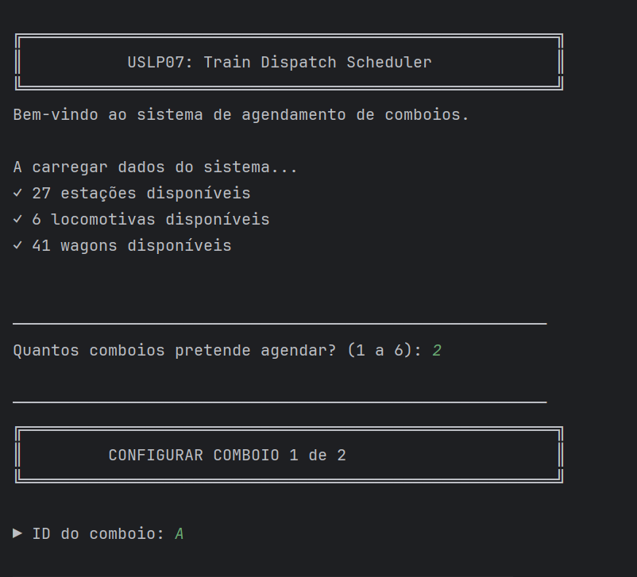
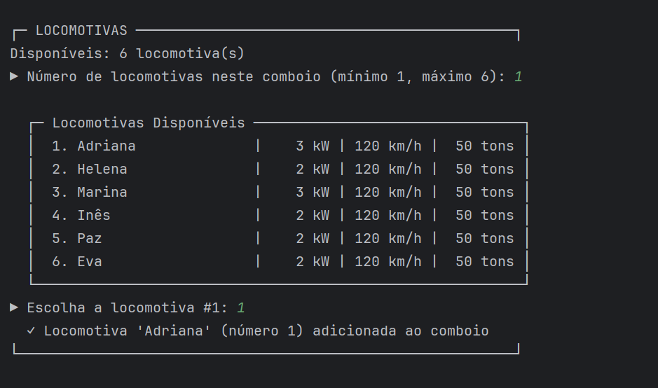
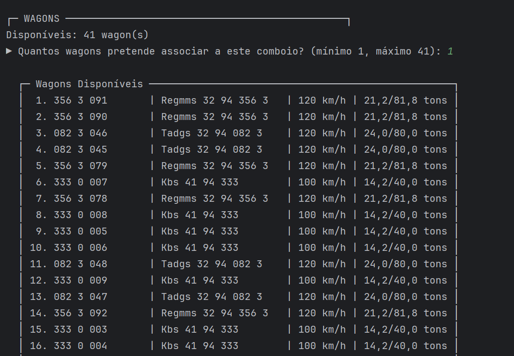
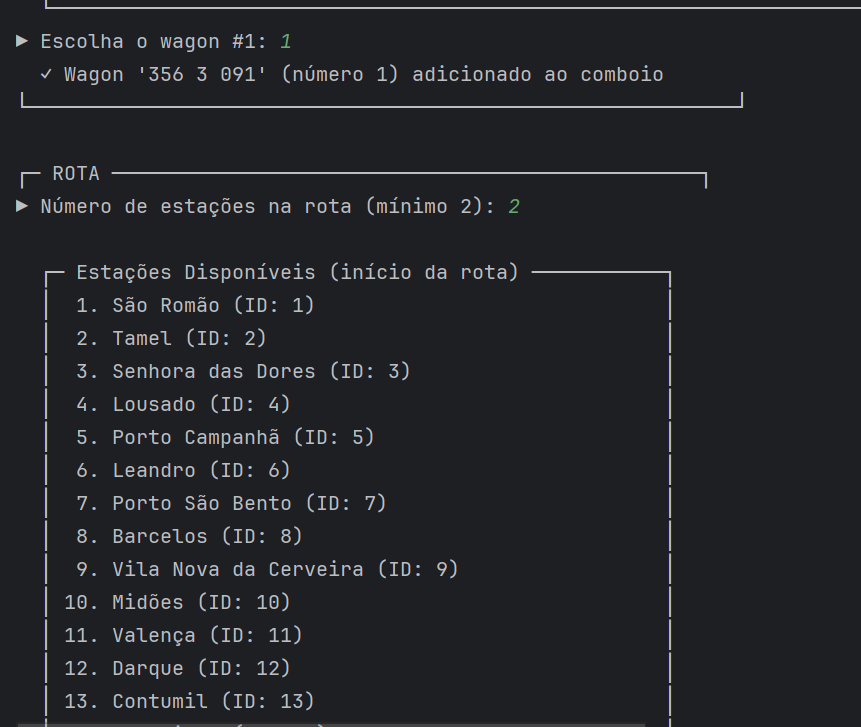
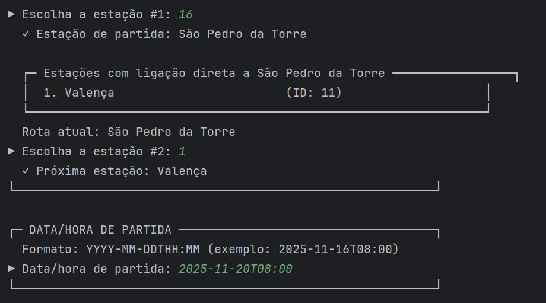
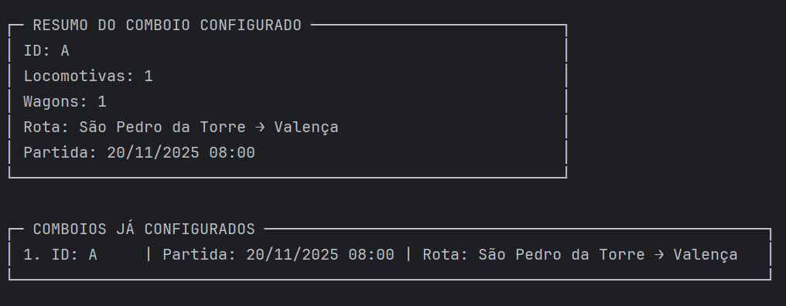
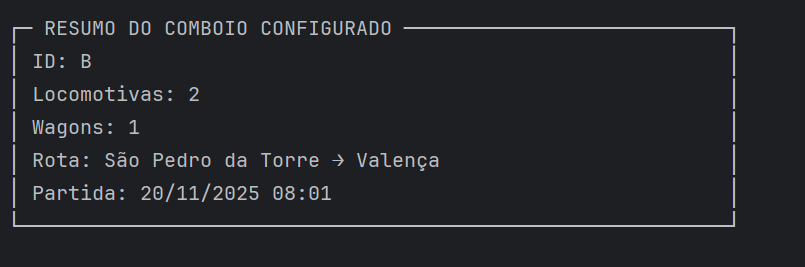
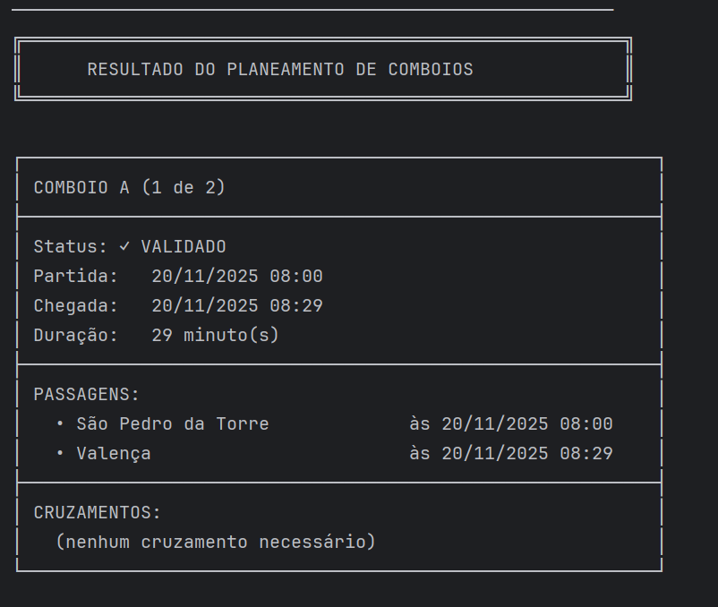
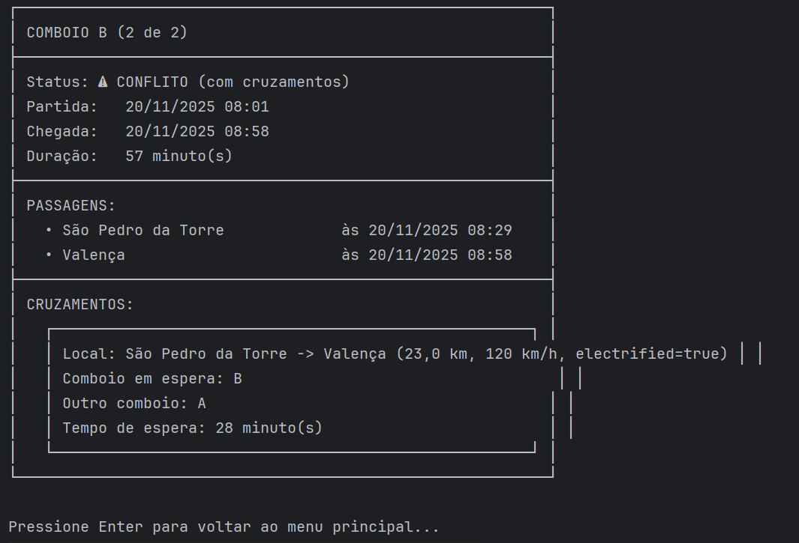

# 1. SINGLE TRACK → Dois comboios na mesma rota quase ao mesmo tempo

**Cenário de Teste:** Simulação de conflito em via única (Linha 7: São Pedro da Torre → Valença).

O objetivo deste teste é verificar a capacidade do algoritmo de detetar que um segmento de via única está ocupado e impedir que um segundo comboio entre na linha antes que o primeiro saia, garantindo a segurança através do re-agendamento automático.

---

### 1.1. Configuração Inicial e Definição do Comboio A

**✔ Funcionalidade e Motivo dos Inputs:**
Ao iniciar o sistema, é solicitado o número de comboios a agendar.
* **Input:** Inseriu-se **"2"**.
* **Porquê:** Para testar a gestão de tráfego, precisamos de no mínimo duas entidades a competir pelo mesmo recurso (a linha férrea) simultaneamente.
* **ID do Comboio:** Definiu-se o primeiro como **"A"** para facilitar a identificação no relatório final.

---

### 1.2. Seleção de Locomotiva (Comboio A)

**✔ Funcionalidade e Motivo dos Inputs:**
O sistema apresenta as locomotivas disponíveis com as suas especificações (potência, velocidade, peso).
* **Input:** Escolheu-se a Locomotiva **#1 (Adriana)**.
* **Porquê:** Para este teste, a capacidade de tração não é o foco do conflito, mas sim o horário. A locomotiva "Adriana" (120 km/h) é suficiente para cumprir a rota, servindo como a locomotiva que terá "prioridade" temporal.

---

### 1.3. Seleção de Wagons (Comboio A)

**✔ Funcionalidade e Motivo dos Inputs:**
O utilizador define a composição da carga. O sistema lista todos os wagons (tara, carga máxima, velocidade).
* **Input:** Selecionou-se **1 wagon** (ID 356 3 091).
* **Porquê:** O objetivo é manter o comboio leve e curto. Isto garante que qualquer atraso ou conflito gerado no resultado final se deve puramente à **ocupação da linha** e não a limitações físicas de velocidade devido a peso excessivo.

---

### 1.4. Definição da Rota (Geografia)

**✔ Funcionalidade e Motivo dos Inputs:**
Nesta etapa define-se o percurso físico que o comboio irá realizar. O sistema valida se as estações possuem ligação direta.
* **Input:** Selecionou-se a Estação de Partida **#16 (São Pedro da Torre)** e a Estação de Destino **#1 (Valença)**.
* **Porquê:** A escolha destas duas estações específicas é fundamental para o teste, pois isola a operação num segmento de via única (*Single Track*), onde o cruzamento simultâneo é fisicamente impossível.

---

### 1.5. Definição do Horário de Partida (Cronologia)

**✔ Funcionalidade e Motivo dos Inputs:**
Após a validação da rota, o sistema solicita o momento exato em que o comboio pretende iniciar a marcha.
* **Input:** Inseriu-se a data/hora: **2025-11-20T08:00**.
* **Porquê:** Este horário serve como "âncora" temporal. Ao definir as 08:00 para o Comboio A, estamos a reservar o segmento de via única neste intervalo exato, criando as condições necessárias para o conflito que será testado com o segundo comboio.

---

### 1.6. Confirmação do Comboio A e Início do Comboio B

**✔ Explicação:**
O sistema confirma que o Comboio A foi configurado com sucesso e está pronto para ser processado (mostra o resumo na parte inferior). Imediatamente, o sistema pede a configuração do segundo comboio. Isto demonstra a capacidade da aplicação de gerir múltiplos agendamentos numa única sessão (*batch processing*).

---

### 1.7. Resumo da Configuração do Comboio B (O "Conflito")

**✔ Funcionalidade e Motivo dos Inputs:**
Aqui vemos o resumo dos inputs inseridos para o segundo comboio.
* **Locomotivas/Wagons:** Configurou-se o Comboio B (Locomotiva Helena, Wagon 356 3 090).
* **Rota:** A **mesma rota** do Comboio A (São Pedro da Torre → Valença).
* **Partida:** **2025-11-20 08:01** (apenas 1 minuto depois do Comboio A).
* **Porquê (Crucial):** Em vias férreas reais, e nesta simulação, 1 minuto não é suficiente para o Comboio A percorrer o trajeto e libertar a linha. Ao inserir "08:01", estamos propositadamente a criar uma **colisão de horários** em via única (*Single Track*) para testar se o algoritmo de segurança dispara.

---

### 1.8. Resultado do Planeamento: Comboio A (Validado)

**✔ Análise do Resultado:**
* **Status:** **VALIDADO**.
* **Explicação:** Como o Comboio A parte às 08:00 e a linha estava livre nesse momento, o sistema atribuiu-lhe prioridade.
* **Dados:** Ele ocupa a linha das 08:00 às 08:29 (29 minutos de duração). Isto significa que o segmento "São Pedro -> Valença" está bloqueado para qualquer outro comboio durante este intervalo.

---

### 1.9. Resultado do Planeamento: Comboio B (Conflito Resolvido)

**✔ Análise do Resultado:**
* **Status:** **⚠ CONFLITO (com cruzamentos)**.
* **O que aconteceu:** O sistema detetou que às 08:01 (hora pedida) a linha ainda estava ocupada pelo Comboio A (que só sai às 08:29).
* **Resolução Automática:**
    1.  O algoritmo identificou o **Segmento Crítico**: São Pedro da Torre -> Valença (*Single Track*).
    2.  Identificou o **Comboio em Espera**: B.
    3.  Calculou o **Tempo de Espera**: 28 minutos.
* **Novo Horário:** O sistema forçou o Comboio B a partir apenas às **08:29** (momento em que o A liberta a linha), chegando às 08:58.
* **Conclusão do Teste:** O teste foi bem-sucedido. A aplicação impediu a colisão e re-agendou o segundo comboio automaticamente, garantindo a segurança da operação ferroviária.