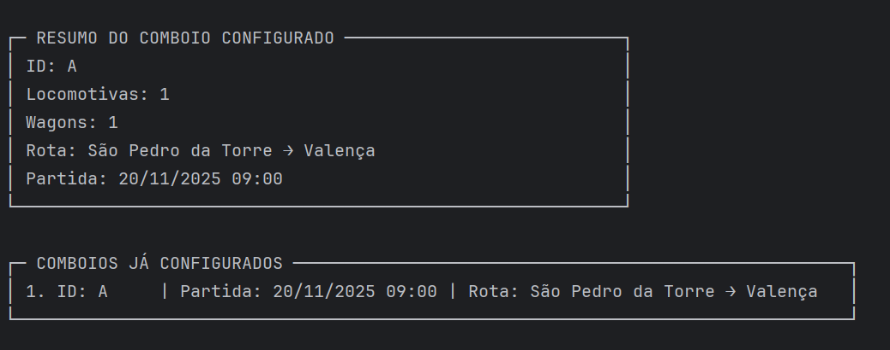
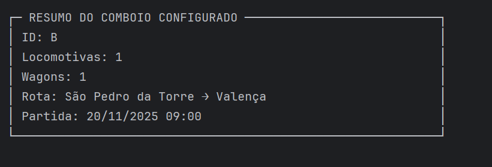
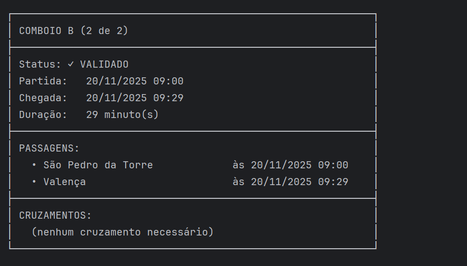
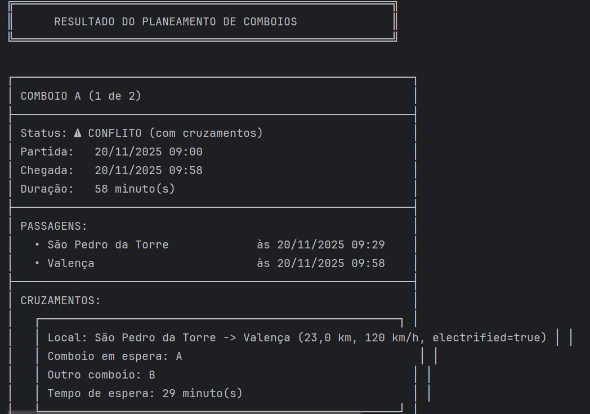

# 2. SINGLE TRACK → Colisão no mesmo sentido (Mesma Hora)

**Cenário de Teste:** Simulação de conflito critico em via única (Linha 7: São Pedro da Torre → Valença) com dois comboios a tentar partir exatamente ao mesmo tempo.

O objetivo é verificar se o sistema impede que dois comboios ocupem o mesmo segmento físico de via única simultaneamente, mesmo que viajem na mesma direção.

---

### 2.1. Configuração dos Comboios (A e B)

**✔ Funcionalidade e Motivo dos Inputs:**
Para forçar uma colisão imediata ("Head-to-head" ou sobreposição total), configuraram-se dois comboios idênticos na rota e horário.
* **Comboio A:** Partida de São Pedro da Torre às **09:00**.
* **Comboio B:** Partida de São Pedro da Torre às **09:00**.
* **Via:** A ligação entre estas estações é **Single Track** (via única).
* **Porquê:** Fisicamente, é impossível dois comboios estarem no mesmo carril à mesma hora. O sistema tem obrigatoriamente de escolher um para passar e outro para esperar.

---

### 2.2. Resultado: Comboio B (Prioridade Atribuída)

**✔ Análise do Resultado:**
* **Status:** **VALIDADO**.
* **Explicação:** O algoritmo de gestão de tráfego analisou o pedido simultâneo e atribuiu o slot das 09:00 ao **Comboio B**.
* **Horário:** O comboio parte à hora planeada (09:00) e chega às 09:29. Durante este intervalo, ele detém a posse exclusiva do segmento de via única.

---

### 2.3. Resultado: Comboio A (Conflito Detetado e Resolvido)

**✔ Análise do Resultado:**
* **Status:** **⚠ CONFLITO (com cruzamentos)**.
* **O que aconteceu:** Como o slot das 09:00 foi atribuído ao Comboio B, o Comboio A não pode partir.
* **Resolução Automática:**
    * **Comboio em Espera:** A (O sistema identificou corretamente que este comboio deve aguardar).
    * **Motivo:** O segmento "São Pedro -> Valença" está ocupado pelo Comboio B.
    * **Tempo de Espera:** **29 minutos**.
* **Novo Horário:** O Comboio A foi re-agendado para partir às **09:29**, o momento exato em que o Comboio B liberta a linha, garantindo a segurança da operação sem intervenção manual.