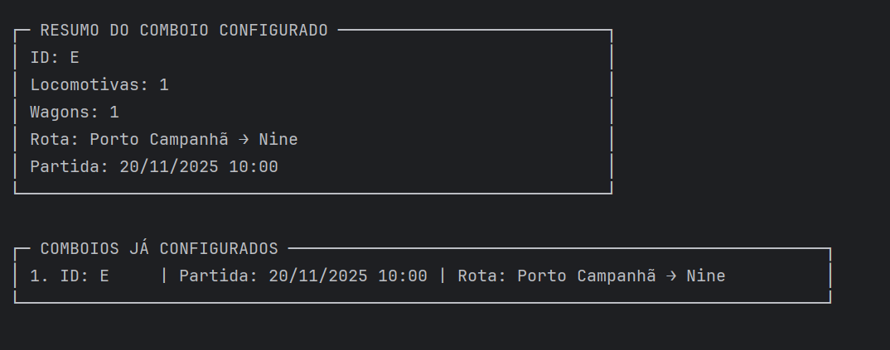
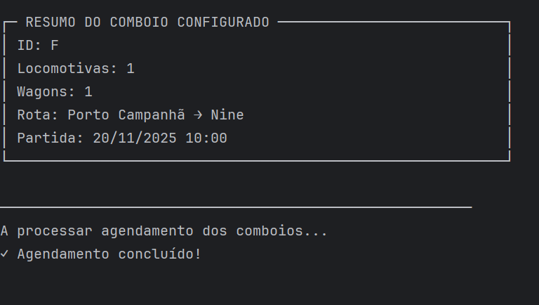
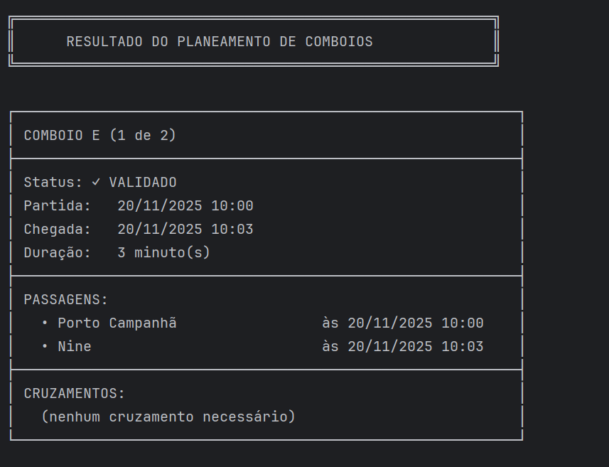
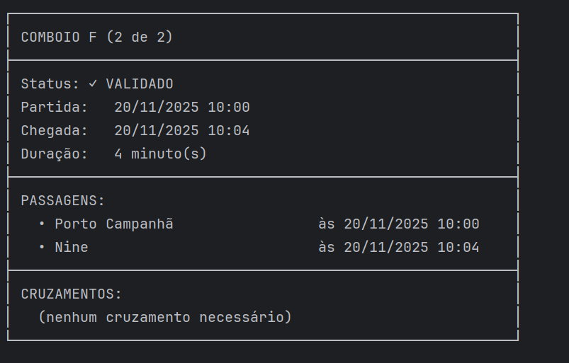

# 3. DOUBLE TRACK → Mesma rota, mesmo horário, impacto do PESO

**Cenário de Teste:** Simulação de tráfego paralelo em via múltipla (Linha 2: Porto Campanhã → Nine) com cargas de peso distinto.

O objetivo deste teste é demonstrar duas funcionalidades críticas:
1.  **Capacidade da Via:** Em linhas com múltiplas vias (*Double/Quadruple Track*), dois comboios podem partir exatamente à mesma hora sem gerar conflitos.
2.  **Motor de Física (Peso):** A duração da viagem varia consoante o peso total do comboio. Comboios mais pesados demoram mais tempo a completar o mesmo percurso devido à inércia e dificuldade de tração.

---

### 3.1. Configuração do Comboio E (Carga Leve)

**✔ Funcionalidade e Motivo dos Inputs:**
Configurou-se o primeiro comboio com uma carga reduzida.
* **Rota:** Porto Campanhã (5) → Nine (20). Esta linha possui 4 vias, permitindo tráfego simultâneo.
* **Locomotiva:** Utilizou-se a Locomotiva 1 (Adriana).
* **Wagon:** Selecionou-se um wagon configurado como **leve** (ID 356 3 091).
* **Partida:** **2025-11-20T10:00**.

---

### 3.2. Configuração do Comboio F (Carga Pesada) e Execução

**✔ Funcionalidade e Motivo dos Inputs:**
Configurou-se o segundo comboio para partir no **mesmo segundo**, mas com uma carga significativamente superior.
* **Rota e Horário:** Exatamente iguais ao Comboio E (**10:00**).
* **Wagon:** Selecionou-se o wagon (ID 333 0 007) que representa uma carga **muito mais pesada**.
* **Objetivo:** Verificar se o sistema penaliza o tempo de viagem do comboio mais pesado, simulando a realidade física onde maior massa exige mais tempo para acelerar e manter a velocidade.

---

### 3.3. Resultado do Planeamento: Comboio E (Leve = Rápido)

**✔ Análise do Resultado:**
* **Status:** **VALIDADO**.
* **Duração:** **3 minutos**.
* **Explicação:** Como este comboio transporta uma carga leve, a locomotiva conseguiu atingir a velocidade ideal rapidamente, completando o percurso no tempo mínimo possível.

---

### 3.4. Resultado do Planeamento: Comboio F (Pesado = Lento)

**✔ Análise do Resultado:**
* **Status:** **VALIDADO** (Sem conflitos de horário, pois a via é dupla).
* **Duração:** **4 minutos**.
* **Conclusão do Teste:**
    1.  **Impacto do Peso:** O sistema calculou corretamente que o Comboio F, sendo mais pesado, demoraria mais tempo a percorrer a mesma distância que o Comboio E. O peso extra resultou num atraso de **1 minuto** na chegada (10:04 vs 10:03).
    2.  **Sucesso na Via Múltipla:** Ambos partiram à mesma hora sem erros, provando que a linha suporta tráfego paralelo.