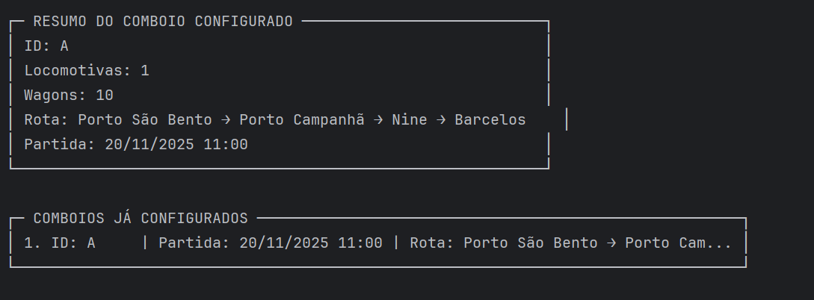
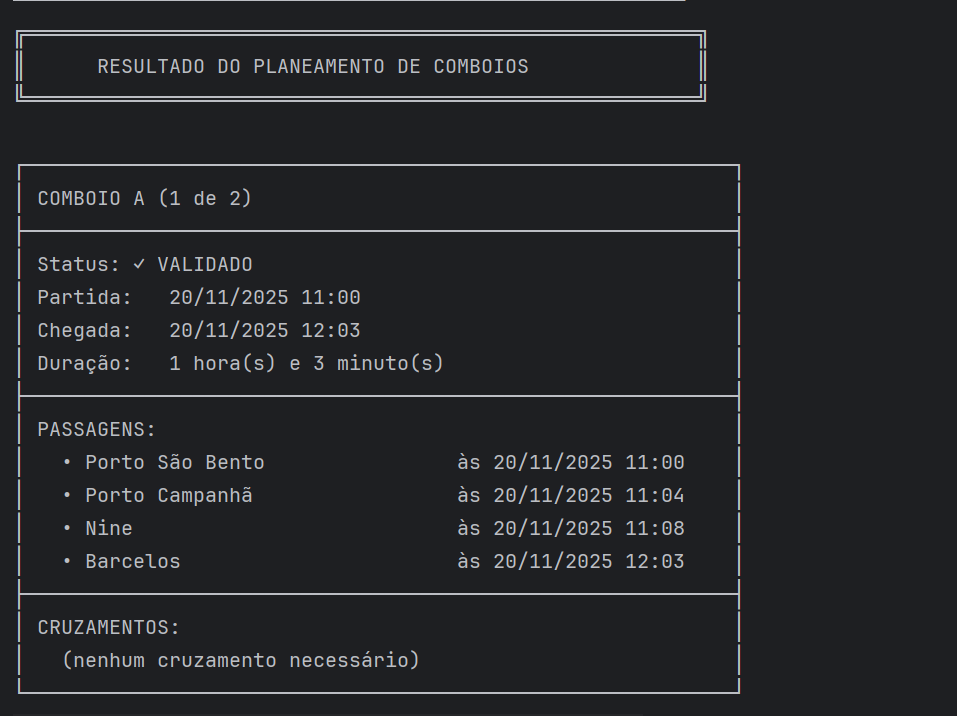
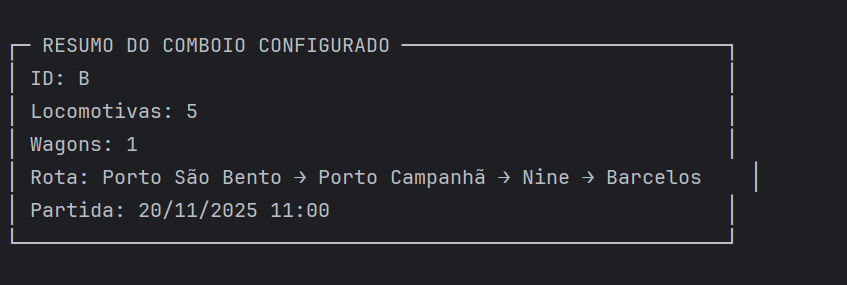
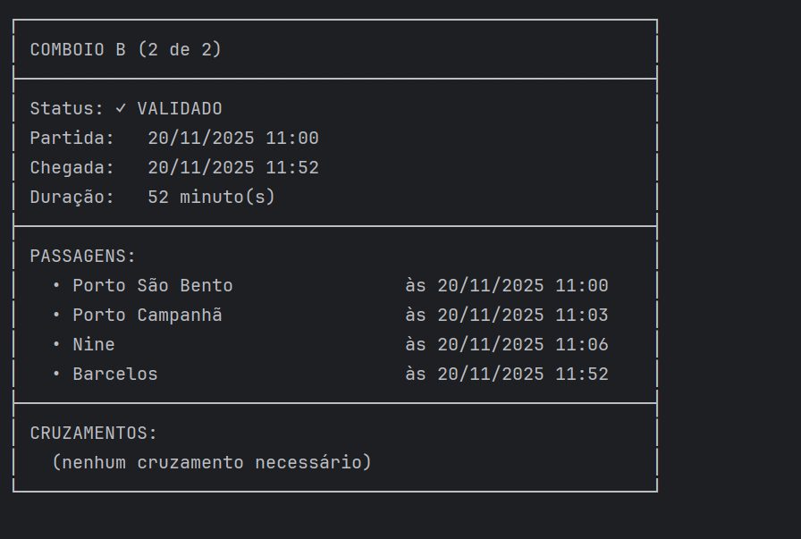

# 4. DOUBLE TRACK → Impacto da Potência (N.º de Locomotivas)

**Cenário de Teste:** Validação do cálculo de velocidade com base na potência total de tração (Linha: Porto São Bento → Barcelos).

O objetivo deste teste é demonstrar como o sistema reage à alteração direta da potência disponível. Mantendo a rota e o horário, variamos drasticamente o número de locomotivas para provar que uma composição com maior capacidade de tração (mais kW) atinge velocidades médias superiores e reduz o tempo de viagem.

---

### 4.1. Configuração do Comboio A (Potência Padrão: 1 Locomotiva)

**✔ Funcionalidade e Motivo dos Inputs:**
Configurou-se o primeiro comboio com uma configuração de tração simples.
* **Locomotivas:** Apenas **1 unidade** (Adriana).
* **Rota:** Porto São Bento → Barcelos.
* **Partida:** 11:00.
* **Resultado:** Com a potência limitada de apenas uma locomotiva, o sistema calculou um esforço maior para mover a composição. O tempo total de viagem foi de **1 hora e 3 minutos**, chegando às 12:03.

---

### 4.2. Configuração do Comboio B (Alta Potência: 5 Locomotivas)

**✔ Funcionalidade e Motivo dos Inputs:**
Para o segundo comboio, aumentou-se drasticamente a força de tração.
* **Locomotivas:** **5 unidades** em simultâneo.
* **Rota:** Exatamente a mesma rota e horário (11:00).
* **Resultado:** O aumento exponencial da potência total disponível permitiu ao comboio manter velocidades mais elevadas, especialmente nas subidas ou arranques. O tempo de viagem desceu para **52 minutos** (chegada às 11:52).

---

### 4.3. Conclusão do Teste

A comparação valida o **Motor de Física** da aplicação no que toca à potência de tração:
1.  **Ganho de Tempo:** A adição de 4 locomotivas extra resultou numa redução direta de **11 minutos** no tempo de viagem.
2.  **Velocidade Média:** O Comboio B, tendo 5x mais motores, conseguiu superar a resistência ao movimento de forma mais eficaz que o Comboio A.
3.  **Independência de Vias:** Ambos os comboios partiram às 11:00 sem conflitos, confirmando o funcionamento da via dupla, mas com desempenhos temporais distintos baseados na configuração das locomotivas.