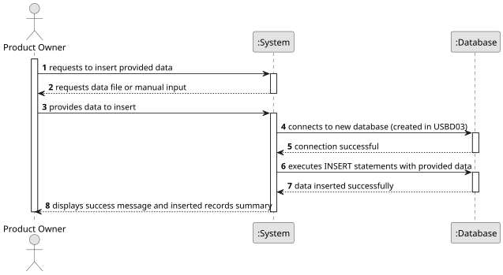

# USBD04 - Insert the provide data into the new database

## 1. Requirements Engineering

### 1.1. User Story Description

As a Product Owner, I want to insert the provided data into the
new database generated in USBD03.

### 1.2. Customer Specifications and Clarifications 

**From the specifications document:**

> none 

**From the client clarifications:**

> **Question:** 

> **Answer:** 

### 1.3. Acceptance Criteria

* **AC1:** The provided data is inserted.
* **AC2:** It will be shown on Oracle LiveSQL.

### 1.4. Found out Dependencies

* Dependency on the USBD03.

### 1.5 Input and Output Data

**Input Data:**

* Provided data

**Output Data:**

* Data

### 1.6. System Sequence Diagram (SSD)

### 1.7 Other Relevant Remarks

* none