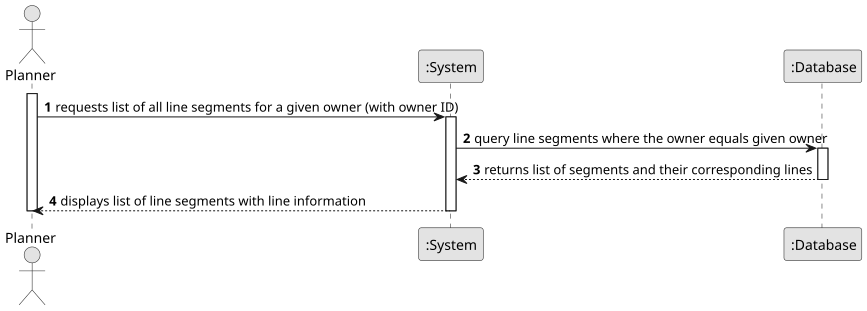

# USBD07 - List of all line segments

## 1. Requirements Engineering

### 1.1. User Story Description

As a planner, I want a list of all line segments of a given owner,
including the line they belong to.

### 1.2. Customer Specifications and Clarifications 

**From the specifications document:**

>	 A line connecting two endpoints is composed of one
or multiple line segments.

>	Rail line segments can be single or double track.

>	In the single-track case, trains must cross at stations or designated areas named
sidings, whereas in the double-track case, trains can cross without losing speed
and without requiring specific facilities.

**From the client clarifications:**

> **Question:** 
>
> **Answer:** 

### 1.3. Acceptance Criteria

* **AC1:** The list of all segments is displayed successfully.
* **AC2:** Minimum acceptance criteria: only the User Stories with data allowing their proper functioning will be evaluated.
* **AC3:** Minimum expected requirement: demonstrated with the data imported in USBD04.

### 1.4. Found out Dependencies

* There is no dependency.

### 1.5 Input and Output Data

**Input Data:**

* none

**Output Data:**

* List of all line segments

### 1.6. System Sequence Diagram (SSD)

### 1.7 Other Relevant Remarks

* none