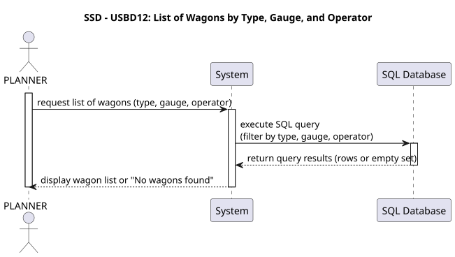

# USBD12 — List of Wagons by Type, Gauge, and Operator

## 1. Requirements Engineering

### 1.1. User Story Description

As a planner, I want a list of all wagons of a given type and gauge that belong to a given operator, so that I can analyze the available rolling stock filtered by operational characteristics and ownership.

This functionality helps planners to quickly identify wagons suitable for specific routes (which depend on track gauge and cargo type) and ensures that only wagons owned or operated by a specific company are considered in operational planning.

---
### 1.2. Customer Specifications and Clarifications

**From the specifications document:**

>Each wagon has the following relevant attributes:
wagon_id, type, gauge, tare, payload_capacity, volume_capacity, operator_id.

>Operators own rolling stock (wagons and locomotives).

>Gauge determines compatibility with railway lines.

>Type indicates the cargo purpose (Boxcar, Flatcar, Tank Car, Hopper Car, Refrigerated Car, etc.).

**From the client clarifications:**

> **Q:** 
> **A:** 

---

### 1.3. Acceptance Criteria

**AC0:** The program must return a list of wagons that match the provided type, gauge, and operator, using the data previously loaded in USBD04.

**AC1:** The system must allow filtering by wagon **type**, returning only records where the type matches the input (case-insensitive).

**AC2:** The system must allow filtering by **gauge**, returning only wagons that match the provided gauge (case-insensitive).

**AC3:** The system must allow filtering by **operator**, returning only wagons belonging to the specified operator.

**AC4:** The query must only return wagons with `status = 'ACTIVE'`.

**AC5:** The results must include at least the following columns: **wagon_id**, **type**, **gauge**, **tare**, **payload_capacity**, **volume_capacity**, **operator_name**.

**AC6:** The output must be sorted by **wagon_id** ascending.

**AC7:** If no wagons match the filters, the system must display the message: `“No wagons found for the given filters.”`

---

### 1.4. Found Out Dependencies

- Depends directly on the creation and initialization of the database structure and data in:
    - **USBD01** — Data Dictionary / Glossary
    - **USBD02** — Relational Model
    - **USBD03** — Database Instantiation
    - **USBD04** — Data Import into the Database

---

### 1.5. Input and Output Data

### 1.5. Input and Output Data

**Input Data:**
- **Parameters (UI / API):**
  - `type` (VARCHAR) — e.g., `'Flatcar'`
  - `gauge` (VARCHAR) — e.g., `'1435mm'`
  - `operator_name` (VARCHAR) — e.g., `'Medway Portugal'`
- **Contextual Data (base de dados):**
  - Tabela `WAGON` com colunas relevantes: `wagon_id`, `type`, `gauge`, `tare`, `payload_capacity`, `volume_capacity`, `operator_id`, `status`
  - Tabela `OPERATOR` com: `operator_id`, `operator_name`
- **Operation:**
  - Execução de uma **consulta (SELECT)** que filtra os registos nas tabelas acima conforme os parâmetros fornecidos (não há importação de ficheiros nesta US).

**Output Data:**
- **Result set (tabela de saída):**
  - Cada linha representa um wagon que satisfaz os filtros, com as colunas mínimas:  
    `wagon_id`, `type`, `gauge`, `tare`, `payload_capacity`, `volume_capacity`, `operator_name`
- **Comportamento / mensagens:**
  - Se houver correspondências: devolve a **lista de wagons** (apresentada na UI, ou exportável para CSV/consola).
  - Se não houver correspondências: devolve a mensagem:  
    **“No wagons found for the given filters.”**
- **Efeitos secundários (opcionais / conforme requisitos não-funcionais):**
  - Registo de auditoria opcional (ex.: `user`, `query_parameters`, `timestamp`, `rows_returned`) caso a política de logging do sistema o exija.

**Exemplo de saída (trecho):**

| WAGON_ID | TYPE    | GAUGE  | TARE  | PAYLOAD_CAPACITY | VOLUME_CAPACITY | OPERATOR_NAME    |
|-----------|---------|--------|-------|------------------|-----------------|------------------|
| W001      | Flatcar | 1435mm | 21000 | 68000            | 90              | Medway Portugal  |
| W002      | Flatcar | 1435mm | 22000 | 70000            | 95              | Medway Portugal  |

---

### 1.6. System Sequence Diagram (SSD)

---

### 1.7. Other Relevant Remarks

- Implementation will be done in PL/SQL using a `SELECT` query or view.
- Must be validated with data imported in **USBD04**.
- Results must match exactly the specified filters, maintaining **data integrity** in the database.
