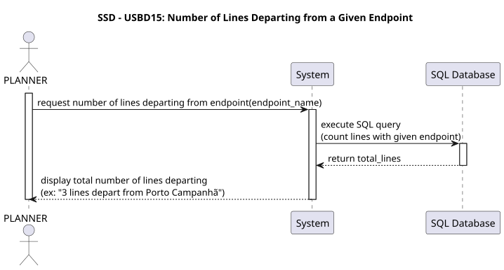

# USBD15 — As a planner, I want to know how many lines depart from a given endpoint.

## 1. Requirements Engineering

### 1.1. User Story Description

As a planner, I want to know how many railway lines depart from a given endpoint, so that I can analyze the connectivity and traffic capacity of each terminal station within the railway network.

This functionality helps planners to evaluate network structure, detect possible bottlenecks, and optimize logistics and maintenance operations.

---
### 1.2. Customer Specifications and Clarifications

**From the specifications document:**

> A **line** connects two or more endpoints (stations).

> Each **endpoint** may serve as a departure or arrival point for several lines.

> The database includes tables such as **LINE**, **LINE_SEGMENT**, and **ENDPOINT**.

> The query must count **how many distinct lines** have the selected endpoint as their **departure point**.

**From the client clarifications:**

> **Q:** 
> **A:** 

---

### 1.3. Acceptance Criteria

**AC0:** The program must return the total number of lines that depart from a given **endpoint**, using the data previously loaded in **USBD04**.

**AC1:** The query must only consider **departures** — endpoints serving as **start points** of a line.

**AC2:** The endpoint name matching must be **case-insensitive**.

**AC3:** If no lines depart from the given endpoint, the system must display:
- “0 lines depart from <endpoint>.”

**AC4:** The implementation must use the tables and relationships defined in **USBD01–USBD04**.

**AC5:** The output must clearly identify both the endpoint name and the number of lines (e.g., “3 lines depart from Porto Campanhã”).

---

### 1.4. Found Out Dependencies

- Depends directly on the database created and populated in:
    - **USBD01** — Data Dictionary / Glossary
    - **USBD02** — Relational Model
    - **USBD03** — Database Instantiation
    - **USBD04** — Data Import into the Database
---

### 1.5. Input and Output Data

**Input Data:**
- **Parameters (UI / API):**
  - `endpoint_name` (VARCHAR) — e.g., `'Porto Campanhã'`
- **Contextual Data (database):**
  - Table `ENDPOINT` with relevant columns: `endpoint_id`, `name`
  - Table `LINE_SEGMENT` with: `segment_id`, `line_id`, `start_point_id`, `end_point_id`
  - Table `LINE` with: `line_id`, `name`
- **Operation:**
  - Execution of a **SELECT** query that counts the distinct lines having the given endpoint as their starting point.

**Output Data:**
- **Result (single record):**
  - Total number of lines departing from the provided endpoint.
- **Behavior / messages:**
  - If lines exist:  
    → Example: **“3 lines depart from Porto Campanhã.”**
  - If no lines exist:  
    → Example: **“0 lines depart from Porto Campanhã.”**

---

### 1.6. System Sequence Diagram (SSD)

---

### 1.7. Other Relevant Remarks

- Implementation will be done in **PL/SQL**, using a `SELECT COUNT()` query.
- Must be validated using the data loaded in **USBD04**.
- The endpoint must exist in the `ENDPOINT` table; if not, result defaults to **0**.
- Query performance should be optimized using indexed foreign keys between `LINE_SEGMENT` and `ENDPOINT`.