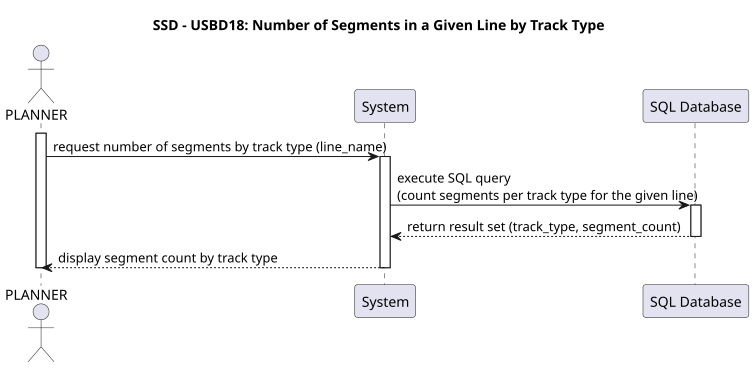

# USBD18 —  As a planner, I want to know the number of segments in a given line, by track type.

## 1. Requirements Engineering

### 1.1. User Story Description
As a planner, I want to know the number of segments in a given line, by track type, so that I can analyze the structure and composition of railway lines according to the type of track (e.g., single, double, electrified, etc.).

This functionality allows planners to understand how the infrastructure of each line is distributed and to support maintenance or upgrade planning decisions.

---

### 1.2. Customer Specifications and Clarifications

**From the specifications document:**

> Each **line** is composed of multiple segments.

> Each **segment** has a defined track type, which can be for example single, double, electrified, etc.

> The database contains relevant tables such as `LINE` and `LINE_SEGMENT`.

> The query should group and count the segments of a specific line by their track type.

**From the client clarifications:**

> **Q:**  
> **A:**

---

### 1.3. Acceptance Criteria

**AC0:** The program must return, for a given **line name**, a list showing the number of segments grouped by track type, using the data imported in **USBD04**.

**AC1:** The query must count all segments `(COUNT(segment_id))` belonging to the specified line.

**AC2:** The query must group the results by track type `(GROUP BY track_type)`.

**AC3:** The comparison of line names must be **case-insensitive**.

**AC4:** The output must include the fields `track_type` and `segment_count`.

**AC5:** The results must be **ordered by track_type ascending**.

**AC6:** If the given line has no segments or does not exist, the system must display:
  - “No segments found for the given line.”

---

### 1.4. Found Out Dependencies

- Depends directly on the database creation and data import defined in:
    - **USBD01** — Data Dictionary / Glossary
    - **USBD02** — Relational Model
    - **USBD03** — Database Instantiation
    - **USBD04** — Data Import into the Database

---

### 1.5. Input and Output Data

**Input Data:**
- **Parameters (UI / API):**
  - `line_name` (VARCHAR) — e.g., `'Linha do Norte'`
- **Contextual Data (database):**
  - Table `LINE` with columns: `line_id`, `name`
  - Table `LINE_SEGMENT` with columns: `segment_id`, `line_id`, `track_type`
- **Operation:**
  - Execution of a **SELECT** query that counts all segments of the given line, grouped by track type.

**Output Data:**
- **Result (table of values):**
  - Each record represents a track type and the corresponding number of segments.
- **Behavior / messages:**
  - If results exist:  
    → Example table:

    | TRACK_TYPE | SEGMENT_COUNT |
        |-------------|----------------|
    | Double      | 4              |
    | Single      | 12             |
  - If no results:  
    → **“No segments found for the given line.”**

---

### 1.6. System Sequence Diagram (SSD)

---

### 1.7. Other Relevant Remarks

- Implementation will be done using **PL/SQL** or **SQL SELECT GROUP BY**.
- Must be validated using the data imported in **USBD04**.
- Line names must be matched case-insensitively.
- Results must clearly identify each track type and its corresponding count.
- Query should be optimized to use indexes on `line_id` and `track_type` for performance.
