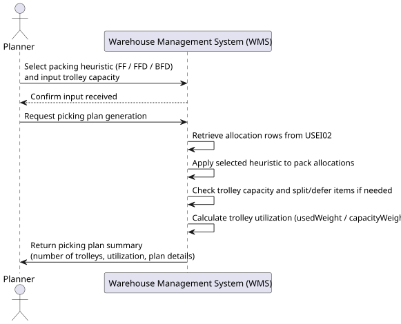

# USEI03 — Picking Plans

## 1. Requirements Engineering

### 1.1. User Story Description

To satisfy the list of orders elaborated in the previous USEI02, it is  required to collect products from one or more points
in the warehouse – a process named “picking”. Pickers often use a trolley (or cart) to collect items, but all trolleys have 
a weight (kg) capacity that must be respected. Therefore, it is necessary to have  a pick plan that dispatches orders, or 
parts of orders, that fit within the capacity of the trolley. So, pickers can safely transport without exceeding the trolley’s capacity.

**User Story:**
> As a planner, I want to pack the allocation rows produced by USEI02 into capacity-bounded trolleys, choosing one of the packing heuristics. So pickers can complete runs without overloading trolleys.

---

### 1.2. Customer Specifications and Clarifications

**From the specifications document:**

- In the warehouse, the following packing heuristics are used:
  - First Fit (FF): Place the item in the first available trolley, where it fits. The scan order should be the input order 
  of the allocation rows.
  - First Fit Decreasing (FFD): Sort unpicked allocations from US02 by weight from largest to smallest and place the item
  in the first available batch where it fits.
  - Best Fit Decreasing (BFD): Sort all unpicked allocations from US02 by weight, from largest to smallest, and put the 
  item into the batch that will result in the smallest amount of remaining unused capacity, i.e., the tightest fit.

- If a single order line does not fit in the remaining capacity, either:
  - Split it: put part in the current wave, log a “partial allocation,” and carry the remainder to the next trolley; or
  - Defer it entirely: log “skipped due to capacity,” and put the full line in the next trolley.    

**From the client clarifications:**

---

### 1.3. Acceptance Criteria

**AC0:** There is no limit on the number of trolleys (their capacity should be defined by the planner).

**AC1:** The planner must dispatch the orders, executing any one of the three packing heuristics on the same set of order lines.

**AC2:** For each heuristic, it must be displayed: 
- The total number of trolleys necessary to dispatch the orders
- Utilisation of each trolley (usedWeight/capacityWeight, e.g., 85% full)
- For each trolley, provide the picking plan with all: order ID, line number, aisle, bay number, boxId, SKU, quantity.

---

### 1.4. Found Out Dependencies

- Interacts with:
    - **USEI02** — allocation rows

---

### 1.5. Input and Output Data

**Input Data:**
  - output allocations
  - trolleyCapacity
  - packing heuristic

**Output Data:**
  - total number of trolleys necessary
  - Utilisation of each trolley (usedWeight/capacityWeight)
  - the picking plan with all, for each trolley:
    - order ID
    - line number
    - aisle
    - bay number
    - boxId
    - SKU
    - quantity

---

### 1.6. System Sequence Diagram (SSD)

---

### 1.7. Other Relevant Remarks

