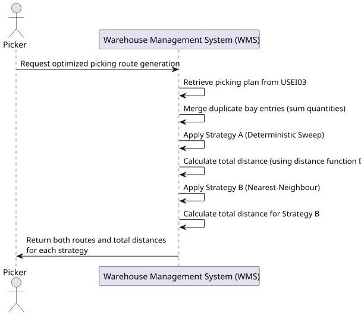

# USEI04 — Pick Path Sequencing

## 1. Requirements Engineering

### 1.1. User Story Description

Optimize the picking route within the warehouse by sequencing bays to minimize the total distance traveled by pickers. 
Using the 2D layout of the warehouse aisles and bays, the system calculates efficient paths based on predefined distance 
rules, applying deterministic and nearest-neighbor strategies to improve operational efficiency.

**User Story:**
> As a picker, I want to plan the task of picking up several boxes, sequenced using a 2D layout (aisles & bays), so I minimize 
walking distance starting from the entrance at the main corridor, with no return leg.

---

### 1.2. Customer Specifications and Clarifications

**From the specifications document:**

- Horizontal spacing between adjacent aisles = 3 units. The definition of the distance function D to go from coordinate (a1, b1) 
to coordinate (a2, b2) is given by the following movement model:
  - Same aisle (a1 == a2) : $D = |b1 − b2|$
  - Different aisles (a1 ̸= a2): must go down from b1 to the main corridor, move
    horizontally and then go up to b2: $D = b1 + |a1 − a2| ∗ 3 + b2$

- Squencing Strategies: 
  - Strategy A — Deterministic sweep
    - Start by sorting the bays of boxes ascending by aisle.
    - Next, calculate the distance to pick the boxes in that order (using the distance function D).
  - Strategy B — Nearest-neighbour (greedy) using the 2D distance above
    - Start by sorting the bays using the distance function D.
    - Next, calculate the distance to pick the boxes in that order (using the distance function D).

-  Route Distance Formula:
  - Let the sequence of the coordinates of the n bays to pick be c1, c2, ... , cn (each ci = (ai,bi), ai being an aisle and 
  bi being a bay), and start c0 = (0,0). The total distance is calculated based on the distance formula D as follows:
    - $Dtotal = ∑ D(Ci,Ci+1)$

**From the client clarifications:**

---

### 1.3. Acceptance Criteria

**AC0:** The input is the set of bays from the picking plan generated in the previous USEI03.

**AC1:** Duplicate bays must be merged into a single stop (sum quantities) before sequencing, otherwise the same bay could appear multiple times in the path.

**AC2:** For a picking plan (set of bays) both strategies must be executed and for each strategy return the path followed and the total distance.

---

### 1.4. Found Out Dependencies

- Interacts with:
    - **USEI03** — picking plan

---

### 1.5. Input and Output Data

**Input Data:**
  - picking plan(set of bays)

**Output Data:**
  - for each strategy:
    - path followed (cordinates)
    - total distance

---

### 1.6. System Sequence Diagram (SSD)

---

### 1.7. Other Relevant Remarks

