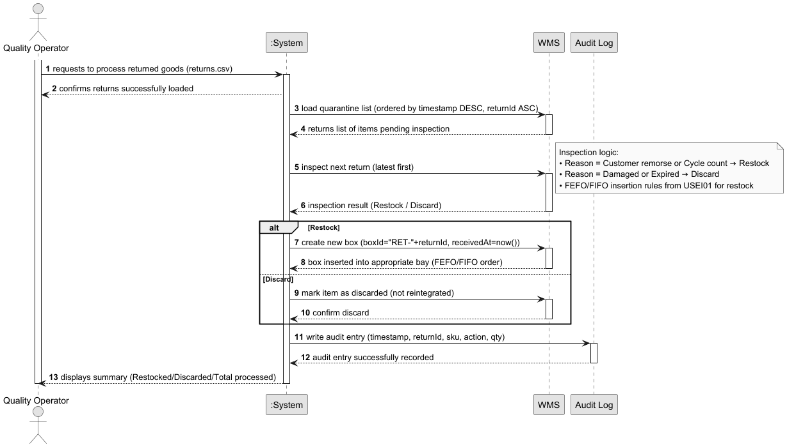

# USEI05 — Returns & Quarantine

## 1. Requirements Engineering

### 1.1. User Story Description

Returned goods cannot immediately re-enter inventory without prior inspection.  
They must first be placed into **quarantine**, ensuring that only suitable products return to stock while damaged or expired ones are safely discarded.

The inspection process must handle returns in **reverse chronological order** (latest first), since recent returns are the most urgent to verify.  
Each inspection must result in either:
- **Restock** — if the product is in good condition.
- **Discard** — if it is damaged, expired, or unsuitable.

Every action performed must be **logged into an audit file** for accountability and traceability, documenting all restock and discard decisions.

**User Story:**
> As a quality operator, I want returned goods to be placed in quarantine so that I can inspect them in the reverse order they arrived (latest first, descending by timestamp, ties by returnId ASC), process them by either discarding or restocking, and create an audit file detailing each product’s outcome.

---

### 1.2. Customer Specifications and Clarifications

**From the specifications document:**

> All returned products must first enter **quarantine**, ensuring they are inspected before reintegration.
>
> The inspection order must be **descending by timestamp**, and in case of equal timestamps, **ascending by returnId**.
>
> Restocked items must be inserted back into the inventory as **new boxes**, following the FEFO/FIFO rules defined in **USEI01**.
>
> Damaged or expired items must be permanently discarded and **not reintegrated** into stock.
>
> Every inspection must write an **audit log entry** to an external file, including timestamp, returnId, SKU, action, and quantities.

**Reasons for returns:**
- **Customer remorse:** item in good condition → restock.
- **Damaged:** unusable → discard.
- **Expired:** past expiry date → discard.
- **Cycle count:** audit mismatch → recheck and restock after verification.

**From the client clarifications:**

> **Q:** What happens to a return with missing expiry date?  
> **A:** Treat as non-perishable; manage with FIFO logic.

> **Q:** How are restocked items inserted into inventory?  
> **A:** As a new box with `boxId = "RET-" + returnId`,  
> `receivedAt = now()`, and `expiryDate` = provided (or null).

> **Q:** Should the audit log be cumulative or overwrite previous data?  
> **A:** It must **append entries**, preserving full inspection history.

> **Q:** What format should the audit log follow?  
> **A:** Plain text or CSV with clear, deterministic structure, e.g.:  
> `2025-09-22 14:32 | returnId=R105 | sku=SKU123 | action=Restocked | qty=8`

---

### 1.3. Acceptance Criteria

**AC0:** All returned items must first be placed in **quarantine** before any inspection.

**AC1:** Items in quarantine are processed in **reverse chronological order**:
- Primary sort: `timestamp DESC`
- Secondary sort: `returnId ASC`

**AC2:** For each inspected return:
- If **Customer remorse** or **Cycle count** → **Restock**.
- If **Damaged** or **Expired** → **Discard**.

**AC3:** When **restocking**:
- Create a **new box** with:
    - `boxId = "RET-" + returnId`
    - `receivedAt = now()`
    - `expiryDate = provided` or `null` if unknown
- Insert the box into the appropriate **bay/aisle** using FEFO/FIFO logic (as per USEI01).

**AC4:** When **discarding**, mark the item as **unusable** and **do not insert it** into inventory.

**AC5:** Each inspection must write a line in the **audit log file** with:

**AC6:** The audit file must append new entries without overwriting previous logs.

**AC7:** The system must support **inspection of multiple returns** sequentially until the quarantine list is empty.

**AC8:** All file operations (loading returns, writing logs) must handle invalid or missing data gracefully, with clear error messages.

---

### 1.4. Found Out Dependencies

- Depends on:
    - **USEI01 — Wagons Unloading**, for reinsertion into inventory (using FEFO/FIFO).
- Produces data consumed by:
    - **Warehouse stock monitoring subsystem**.
- Requires valid datasets:
    - `returns.csv` — containing returnId, SKU, qty, reason, timestamp, expiryDate.

---

### 1.5. Input and Output Data

**Input Data:**
- **returns.csv**
    - `returnId`, `SKU`, `qty`, `reason`, `timestamp`, `expiryDate`
- Warehouse state (loaded from previous operations).

**Output Data:**
1. Updated warehouse inventory (if restocks occurred).
2. **Audit log file** (e.g., `returns_audit.log`):
    - One line per processed return, with timestamp, returnId, SKU, action, qty.
3. Console feedback summarizing:
    - Total restocked
    - Total discarded
    - Total inspected

---

### 1.6. System Sequence Diagram (SSD)

---

### 1.7. Other Relevant Remarks

- The inspection algorithm must process returns using a **stack-like (LIFO)** structure to ensure latest-first order.
- FEFO/FIFO insertion rules must be reused from **USEI01** implementation.
- All logic must be implemented using **primitive Java constructs** (loops, conditionals, collections).
- **TDD** must be followed — tests verifying restock, discard, and audit logging are mandatory.
- Code coverage must reach **≥ 80% (JaCoCo)**.
- The system must maintain **data integrity** between inventory and quarantine structures.
- The audit log must remain **human-readable** and suitable for compliance verification.  
