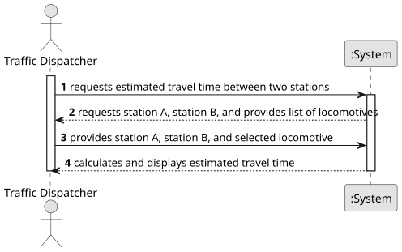

# USBD04 - Calculate the estimate travel time between two stations

## 1. Requirements Engineering

### 1.1. User Story Description

As a Traffic Dispatcher, I want to calculate the estimated travel time
between two stations, with a direct connection between them, and a selected
locomotive.

### 1.2. Customer Specifications and Clarifications 

**From the specifications document:**

> Locomotives: Engines that pull the freight trains.

> Locomotives can be powered by electricity or diesel fuel.

> They can be coupled together in a train to provide the power required to pull all the freight carriages.

>  Some of the most important characteristics are the make, model, year of entry into service, type (diesel,
electric), power, and acceleration, dimensions, maximum/total weight, fuel
capacity (only diesel engines), and gauge (some may support multiple gauges).

> Freight yards, stations, and terminals: Facilities for loading, unloading, sorting, and assembling trains.

>  Depending on their importance and purpose, stations and terminals may include warehouses, refrigerated areas, and grain
silos.

**From the client clarifications:**

> **Question:** 

> **Answer:** 

### 1.3. Acceptance Criteria

* **AC1:** The estimated travel time calculated between two stations was successfully completed.
* **AC2:** In this version, acceleration can be assumed to be
  instantaneous. When presenting the results, the sections should be listed in
  the order in which they will be covered, and the speed should be considered
  in the calculation of the trip.

### 1.4. Found out Dependencies

* none

### 1.5 Input and Output Data

**Input Data:**

* Selected locomotive 
* Station A 
* Station B 

**Output Data:**

* Calculated time

### 1.6. System Sequence Diagram (SSD)

### 1.7 Other Relevant Remarks

* none