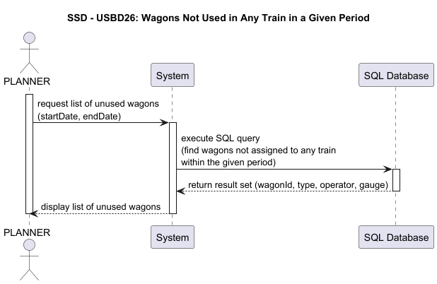

# USBD26 — List Wagons Not Used in Any Train in a Given Period

## 1. Requirements Engineering

### 1.1. User Story Description

To support planning and fleet utilization analysis, the system must identify all wagons that were **not used** in any train during a specified time period. Fleet managers must be able to determine idle wagons that could be reallocated, maintained, or optimized for reduced operational cost.

**User Story:**
> As a planner, I want a list of the wagons that were not used in any train in a given period, so that I can analyze fleet inactivity and improve wagon usage.

---

### 1.2. Customer Specifications and Clarifications

**From the specifications document:**

> Wagons linked to at least one train (through scheduled or executed routes) inside the declared time interval must **not** appear in the results.

> Only wagons that are **completely unused** during the interval should be listed.

> Date filtering must consider:
> - Train planned departure/arrival timestamps
> - Wagon use logs when coupled to a train

**From client clarifications:**

> **Q:** What is the definition of a wagon in use?  
> **A:** A wagon is considered *used* if it is assigned to any **train composition** whose operational time intersects the selected date range.

> **Q:** Are locomotives included in this query?  
> **A:** No. Only wagons registered in the rolling stock dataset.

> **Q:** How must the PL/SQL solution be delivered?  
> **A:** A stored function returning a `SYS_REFCURSOR`.

> **Q:** What if the user provides an invalid or reversed date range?  
> **A:** The function must return an empty result set gracefully.

---

### 1.3. Acceptance Criteria

| ID | Description |
|----|-------------|
| **AC1** | The query must only return **wagons** that were not used in any train within the provided date range. |
| **AC2** | The query must support configurable date range parameters (`startDate`, `endDate`). |
| **AC3** | The result must include: `wagonId`, wagon type, operator, and gauge. |
| **AC4** | The solution must be delivered as a **PL/SQL function returning a `SYS_REFCURSOR`**. |
| **AC5** | If no wagons match criteria, the function must return an **empty result set** (not NULL). |
| **AC6** | Input validation must prevent crashes due to invalid dates. |

---

### 1.4. Found Out Dependencies

This user story depends on:

- **Rolling Stock Model**:
    - Must include wagon metadata such as type, operator, and gauge.
- **Train Composition / Assignment Model**:
    - Mapping between wagons and trains must be correctly modeled.
    - Existence of timestamps tied to train schedules or movement events.

It interacts with:
- Reporting subsystem for planners
- Fleet operations analytics components

---

### 1.5. Input and Output Data

#### Input Parameters:
| Parameter | Type | Description |
|----------|------|-------------|
| `startDate` | DATE | Lower bound of the analysis period |
| `endDate` | DATE | Upper bound of the analysis period |

#### Output Data (Query Result):
| Field | Description |
|-------|-------------|
| wagonId | Unique identifier of the wagon |
| wagonType | Type classification (e.g., boxcar, tanker) |
| operator | Company owner of the wagon |
| gauge | Line gauge compatibility |

---

### 1.6. System Sequence Diagram (SSD)

📌 *To be created when UI interaction is defined — currently a direct PL/SQL execution.*

Placeholder:

---

### 1.7. Other Relevant Remarks

- Performance must scale efficiently with increasing real datasets.
- Train-wagon assignment should consider:
    - Planned schedules
    - Real execution logs (if available)
- Query must handle:
    - Wagons that never entered operation
    - Wagons suspended or in maintenance (still considered unused)
- Must ensure **data integrity** in filtering logic (temporal intersection rules)

---
