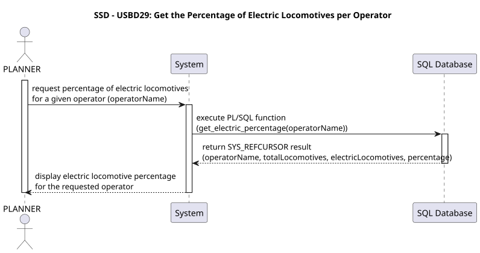

# USBD29 - Get the Percentage of Electric Locomotives per Operator

## 1. Requirements Engineering

### 1.1. User Story Description

As a **planner**, I want to know the **percentage of electric locomotives** of a given operator, so that I can analyze the electrification level of the operator’s locomotive fleet.

---

### 1.2. Customer Specifications and Clarifications

**From the specifications document:**

> A PL/SQL function must be implemented for each user story, returning a **SYS_REFCURSOR**.  
> Only user stories with data allowing their proper functioning will be evaluated.  
> Every query must have at least one record.  
> Whenever possible, data imported into **USBD23** must be used.

**From the client clarifications:**

> **Question:** What defines whether a locomotive is considered electric?  
> **Answer:** A locomotive is considered electric if its **type** or **propulsion system** is classified as `"Electric"` in the database.

> **Question:** How should the percentage be calculated?  
> **Answer:** It should be calculated as `(Number of electric locomotives / Total locomotives of the operator) * 100`.

> **Question:** What should the function return?  
> **Answer:** The function should return a **SYS_REFCURSOR** with the operator name and the calculated percentage of electric locomotives.

---

### 1.3. Acceptance Criteria

* **AC1:** The PL/SQL function must calculate the percentage of electric locomotives per operator.
* **AC2:** The function must use data imported in **USBD23**, when available.
* **AC3:** The function must return a **SYS_REFCURSOR** with at least one record.
* **AC4:** Each record must include:
  - The operator name
  - The total number of locomotives
  - The number of electric locomotives
  - The calculated percentage
* **AC5:** The percentage must be formatted to two decimal places.
* **AC6:** The query must handle division correctly (avoid division by zero).

---

### 1.4. Found out Dependencies

* Depends on **USBD23** for base locomotive and operator data.
* Depends on the **locomotive** and **operator** tables (or equivalent data structures).

---

### 1.5. Input and Output Data

**Input Data:**

* Operator name or operator identifier (parameter in the PL/SQL function)
* Locomotive data (from database tables imported in USBD23)

**Output Data:**

* A **SYS_REFCURSOR** containing:
  - Operator name
  - Total locomotives
  - Electric locomotives
  - Electric percentage (as numeric or formatted string)

---

### 1.6. System Sequence Diagram (SSD)



---

### 1.7. Other Relevant Remarks

* The calculation must ensure consistent data integrity between operator and locomotive tables.
* The function must be optimized for use within Oracle LiveSQL.
* Example PL/SQL function name suggestion:
  ```
  FUNCTION get_electric_percentage (p_operator IN VARCHAR2)
  RETURN SYS_REFCURSOR;
  ```
* Should be tested with multiple operators to validate correct aggregation and percentage calculation.  
