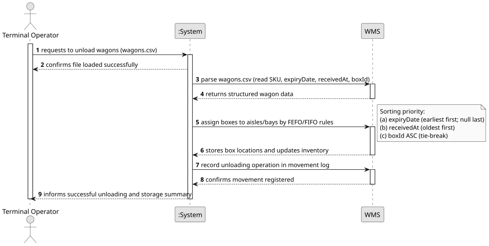

# USEI01 — Wagons Unloading (Inventory Replenishment)

## 1. Requirements Engineering

### 1.1. User Story Description

When wagons arrive at the terminal and are unloaded into warehouses, the system must manage how products are stored and dispatched to maintain **inventory accuracy**, **traceability**, and **operational efficiency**.

Perishable goods must follow the **First-Expired-First-Out (FEFO)** principle, ensuring that items closest to their expiry date are dispatched first, minimizing spoilage and waste.

Non-perishable goods, without expiry dates, must follow **First-In-First-Out (FIFO)** discipline to ensure fair stock rotation and prevent stagnation.

Each product SKU is stored in boxes, each with a **unique location code** (Aisle/Bay). Every operation — unloading, relocation, transfer, or dispatch — must be **recorded in the Warehouse Management System (WMS)** to ensure traceability.

**User Story:**
> As a terminal operator, I want unloading operations of wagons to automatically store inventory using FEFO and/or FIFO logic, so that I can ensure the correct dispatch order and minimize product spoilage.

---

### 1.2. Customer Specifications and Clarifications

**From the specifications document:**

> The WMS must automatically determine where and how to store each unloaded box, based on expiry dates and receiving order.

> Each item with a unique SKU must be stored in a unique Bay/Aisle location.

> The system must always respect FEFO/FIFO rules depending on the product type.

> When dispatching stock, consumption must follow the correct order (earliest expiry or oldest received).

> Empty bays must remain registered in the system; only boxes are deleted.

> Partial dispatch across multiple bays must be supported, following ascending bay numbering.

> Every movement (unloading, relocation, transfer, dispatch) must update the WMS log for full traceability.

**From the client clarifications:**

> **Q:** How are expiry dates represented in the CSV files?  
> **A:** Expiry dates are stored in ISO format (`YYYY-MM-DD`). Null means non-perishable.

> **Q:** Can a wagon contain multiple SKUs?  
> **A:** Yes. Each row in `wagons.csv` represents one SKU within a wagon.

> **Q:** What happens if two boxes have the same expiry date and receivedAt timestamp?  
> **A:** Sort by boxId ascending as a tie-breaker.

> **Q:** When relocating a box, do we re-sort the entire bay?  
> **A:** No, only insert the relocated box in the correct FEFO position.

> **Q:** What happens to empty bays after dispatch?  
> **A:** Bays remain in the WMS but contain zero boxes.

---

### 1.3. Acceptance Criteria

**AC0:** The system must support the initialization of stock during wagon unloading from a `wagons.csv` file.

**AC1:** Each product (SKU) must be assigned to a **specific aisle and bay**, and its position determined by:
- (a) **expiryDate** (earliest first; `null` last)
- (b) **receivedAt** (oldest first)
- (c) **boxId** ascending (tie-break)

**AC2:** During **dispatch**, the system must always consume stock from the **front of the bay list**, ensuring FEFO/FIFO behavior.

**AC3:** If a bay becomes empty, it must **remain registered** in the WMS (only boxes are removed).

**AC4:** **Partial dispatch** must be supported:
- If one bay runs out of a SKU, the system continues in the next bay (ascending number) holding that SKU.

**AC5:** **Relocation operations** must update only the box’s warehouseId, aisle, and bay — without re-sorting unless expiryDate/receivedAt changes.

**AC6:** All stock movements (unloading, relocation, dispatch) must be recorded in the **WMS log** for full traceability.

---

### 1.4. Found Out Dependencies

- Depends on **warehouse structure definitions** (aisles, bays, SKUs) from the **initial configuration CSV files**.
- Interacts with:
    - **USEI02** — Dispatch Operations
    - **USEI03** — Relocation Management
    - **USEI04** — Sequencing and Picking Optimization

---

### 1.5. Input and Output Data

**Input Data:**
- **File input:** `wagons.csv`, containing for each box:
    - `wagonId`
    - `SKU`
    - `expiryDate` (nullable)
    - `receivedAt`
    - `boxId`
- **Operations:**
    - Unloading
    - Relocation
    - Dispatch

**Output Data:**
- Updated **warehouse state** (aisle/bay contents).
- Updated **WMS log** with all stock movements.
- Console or CSV-based feedback on actions performed.

---

### 1.6. System Sequence Diagram (SSD)

---

### 1.7. Other Relevant Remarks

- The **WMS must enforce FEFO/FIFO logic** dynamically when products are unloaded, relocated, or dispatched.
- **All operations** must use **primitive Java constructs** (loops, conditionals, collections).
- **No Stream API** or external sorting libraries are allowed.
- The system must be designed for **traceability**, **auditability**, and **future integration** with a database (Oracle DBMS).
- **Test-Driven Development (TDD)** is mandatory — tests must verify FEFO/FIFO behavior, correct sorting, and consistency across dispatch and relocation.  
