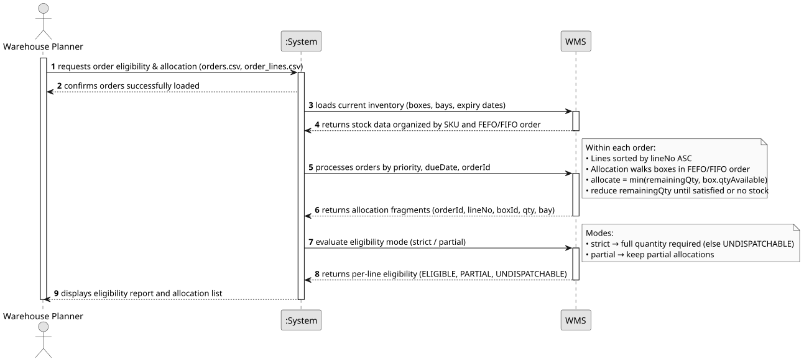

# USEI02 — Order Eligibility & Allocation

## 1. Requirements Engineering

### 1.1. User Story Description

A warehouse planner must fulfill the customer orders received by checking the current warehouse inventory and determining which order lines can be dispatched.  
For each eligible order line, the system must **allocate quantities from boxes** according to the **FEFO (First-Expired-First-Out)** or **FIFO (First-In-First-Out)** rules, ensuring fairness and minimizing waste.

The outcome consists of:
- A list of per-line **eligibility statuses**: `ELIGIBLE`, `PARTIAL`, or `UNDISPATCHABLE`.
- A list of **allocation rows** (order, line, box, quantity, bay/aisle) for dispatch planning.

**User Story:**
> As a warehouse planner, when I receive open orders, I want the system to examine current inventory and allocate quantities from boxes in FEFO order, and produce per-line statuses (ELIGIBLE, PARTIAL, UNDISPATCHABLE) and a list of allocation rows with box and bay information.

---

### 1.2. Customer Specifications and Clarifications

**From the specifications document:**

> Orders must be processed in the following order:  
> **priority ASC**, **dueDate ASC**, **orderId ASC**.

> Within each order, lines must be processed by **lineNo ASC**.

> Allocation walks through all available boxes of the SKU in **FEFO/FIFO** order.

> For each visited bay, the system must allocate the minimum between the **remaining quantity** and the **available box quantity**:  
> `allocated = min(remainingQty, box.qtyAvailable)`

> After each allocation, reduce the `remainingQty`.  
> The system continues until the line’s requested quantity is satisfied or no more boxes are available.

> The **available quantity of any box** must **never drop below zero** during planning.

> The system supports two **modes**:
> - **strict:** a line is `ELIGIBLE` only if its full requested quantity is allocated; otherwise it is `UNDISPATCHABLE`.
> - **partial:** allows `PARTIAL` status if only part of the requested quantity can be allocated.

> The **default mode** is `strict`.

**From the client clarifications:**

> **Q:** Can orders have different SKUs and multiple lines?  
> **A:** Yes. Each order may have multiple lines (one per SKU).

> **Q:** What happens if the requested quantity exceeds available stock?  
> **A:** In strict mode, the line is `UNDISPATCHABLE`. In partial mode, it becomes `PARTIAL`.

> **Q:** Should partially allocated lines still produce allocation rows?  
> **A:** Yes, but only in partial mode.

> **Q:** Is the allocation result persisted or just simulated?  
> **A:** It’s simulated for planning — no stock is removed from inventory at this stage.

> **Q:** What is returned by the allocation operation?  
> **A:** Two outputs:
> 1. A list of per-line eligibility statuses.
> 2. A list of allocation fragments (orderId, lineNo, sku, qty, boxId, aisle, bay).

---

### 1.3. Acceptance Criteria

**AC0:** Orders must be loaded from `orders.csv` and `order_lines.csv`, and matched with stock from `wagons.csv` (inventory).

**AC1:** Orders are processed in order of:
- `priority` ascending
- `dueDate` ascending
- `orderId` ascending

**AC2:** Within each order, lines are processed in order of `lineNo ASC`.

**AC3:** Allocation for each line walks the SKU’s boxes in **FEFO/FIFO** order (depending on expiry date).

**AC4:** For each visited bay:
- allocate `min(remainingQty, box.qtyAvailable)`
- reduce `remainingQty`
- continue until full or no stock remains

**AC5:** Box quantities must never become negative during allocation.

**AC6:** Two operational modes must be supported:
- **Strict mode:**
    - line is `ELIGIBLE` only if fully allocated
    - else marked `UNDISPATCHABLE` and allocations are discarded
- **Partial mode:**
    - if `0 < allocated < requested`, mark `PARTIAL`
    - if `allocated = 0`, mark `UNDISPATCHABLE`

**AC7:** The system must return:
1. **Eligibility report**:
    - `orderId`, `lineNo`, `sku`, `requestedQty`, `allocatedQty`, `status`
2. **Allocation details** (per fragment):
    - `orderId`, `lineNo`, `sku`, `qty`, `boxId`, `aisle`, `bay`

**AC8:** Allocation results must be displayed or exportable as `.csv` files for further use by dispatch planning (USEI03).

---

### 1.4. Found Out Dependencies

- Depends on stock created and organized in **USEI01 (Wagons Unloading)**.
- Provides allocation outputs consumed by:
    - **USEI03 — Picking Plans**
    - **USEI04 — Pick Path Sequencing**
- Requires access to loaded datasets:
    - `orders.csv`
    - `order_lines.csv`
    - `wagons.csv`
    - `bays.csv`

---

### 1.5. Input and Output Data

**Input Data:**
- **orders.csv:** `orderId`, `dueDate`, `priority`
- **order_lines.csv:** `orderId`, `lineNo`, `sku`, `qty`
- **inventory:** built from USEI01 (list of boxes by `boxId`, `SKU`, `qtyAvailable`, `expiryDate`, `aisle`, `bay`)

**Output Data:**
1. **Eligibility List** (`eligibility_report.csv`)
    - `orderId`, `lineNo`, `sku`, `requestedQty`, `allocatedQty`, `status`
2. **Allocation List** (`allocations.csv`)
    - `orderId`, `lineNo`, `sku`, `qty`, `boxId`, `aisle`, `bay`

---

### 1.6. System Sequence Diagram (SSD)

---

### 1.7. Other Relevant Remarks

- The system must **not modify the actual stock quantities** — allocation is **simulation-only**.
- FEFO/FIFO logic must follow the ordering rules defined in **USEI01**.
- Allocation algorithms must be implemented using **primitive Java constructs only** (loops, conditionals, collections).
- No Java Stream API or external sorting libraries allowed.
- All allocation and eligibility logic must be **unit tested (JUnit 5)** with **TDD**.
- **Code coverage ≥ 80%**, verified via **JaCoCo**.
- Results must be deterministic for identical inputs.  
