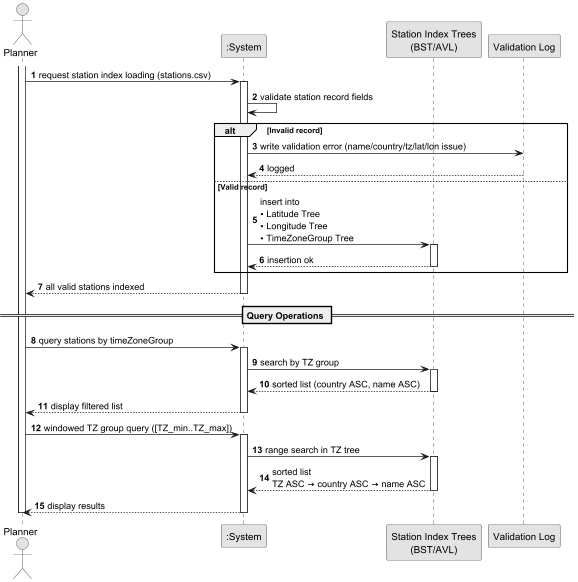

# USEI06 — Time-Zone Index and Windowed Queries

## 1. Requirements Engineering

### 1.1. User Story Description

To support planners in fast and deterministic lookups of railway stations, the system must provide **indexed structures** that allow efficient searching and sorting of stations by:

- **Latitude**
- **Longitude**
- **Time Zone Group**
- **Country**

These indexes must allow:
- Exact lookups (e.g., stations of a given time zone group)
- Sorted listings
- Searching inside a **window/range** of time-zone groups
- Filtering by country

Since the dataset contains ~64k stations across Europe, a sequential scan is too slow and would not meet performance expectations.

**User Story:**
> As a planner, I want a set of BST/AVL trees that lets me quickly search by latitude, longitude, time-zone group and country, so I can efficiently retrieve stations filtered and ordered without scanning the entire dataset.

---

### 1.2. Customer Specifications and Clarifications

**From the specifications document:**

> Each station record is validated before insertion into any index tree.
> If invalid, the station must be rejected and logged.

> Searching by time-zone group must return results ordered **ascending by country**, and then by station name.

> Searching in a **window of time-zone groups** must return results sorted as:
> - time-zone group ASC
> - country ASC
> - station name ASC

> Multiple stations may share the same coordinates; they must be stored **without overwriting** existing entries.

**From client clarifications:**

> **Q:** What is a time-zone group?  
> **A:** A standardized group identifier found in station data: e.g., `CET`, `WET/GMT`, `EET`.

> **Q:** What happens if two stations have identical (lat, lon)?  
> **A:** Sort them **by station name ASC** under the same node.

> **Q:** How should invalid attributes be handled during loading?  
> **A:** Discard the record and log a validation message for traceability.

> **Q:** How must trees behave?  
> **A:** Must guarantee **deterministic ordering** and **balanced search operations**.

---

### 1.3. Acceptance Criteria

| ID | Requirement |
|----|-------------|
| **AC0** | Stations must be loaded and validated before insertion into any tree. |
| **AC1** | Invalid rows must be rejected with a meaningful validation log. |
| **AC2** | Three independent BST/AVL structures must be created to index stations by: latitude, longitude, and time-zone group. |
| **AC3** | Duplicate coordinates must be allowed and sorted by station name ASC. |
| **AC4** | Querying by one time-zone group must return results sorted by: country ASC → name ASC. |
| **AC5** | Windowed time-zone query must return results sorted by: time-zone group ASC → country ASC → name ASC. |
| **AC6** | Structures must support efficient searches (logarithmic average case). |
| **AC7** | Tests must validate indexing and query correctness, ordering, and filtering behavior. |

---

### 1.4. Found Out Dependencies

- Uses **validated station data** loaded from CSV (Latitude, Longitude, Country, TZ, Name).
- Must handle ~64k entries efficiently.
- Does **not** modify station data — only stores references.

Interacts with:
- **USEI07** — KD-Tree Construction (will reuse this index structure to bulk-build a spatial tree)
- **USEI08–USEI10** — spatial/geographic queries on top of indexed dataset

---

### 1.5. Input and Output Data

#### Input Data:
- `stations.csv` with fields:
    - `name`, `country`, `timeZoneGroup`
    - `latitude` ∈ [-90, 90]
    - `longitude` ∈ [-180, 180]

#### Output Data:
1. **3 BST/AVL Tree data structures**
2. **Query results** returned as sorted collections
3. **Validation logs** for discarded rows (if any)

Example returned fields:
- stationId (if applicable)
- name
- country
- timeZoneGroup
- latitude, longitude

---

### 1.6. System Sequence Diagram (SSD)

---

### 1.7. Other Relevant Remarks

- The index trees must store **references** to station objects, not copies → memory efficiency.
- Ordering rules must remain **stable and deterministic** across runs.
- Mandatory **unit tests** verifying:
    - proper validation
    - balanced insertions
    - correct ordering of duplicated lat/lon entries
    - correct ordering in filtered outputs
- Algorithmic complexity and performance must be **analyzed and documented**.
- Implementation must rely on **basic Java data structures** and class-developed BST/AVL logic (no Java built-in Trees or Streams).

