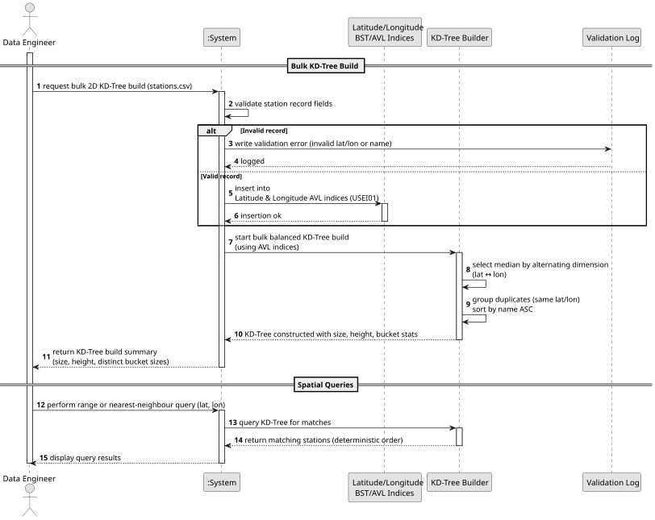

# USEI07 — Build a balanced 2D-Tree on Latitude/Longitude

## 1. Requirements Engineering

### 1.1. User Story Description

Context: We need a spatial index over ~64k European train stations to enable fast geographic queries. A 2D KD-tree on (latitude, longitude) supports range and nearest-neighbour operations much faster than scanning all stations.

**User Story:**
> As a data engineer, I want to build a balanced 2D-tree using (lat, lon) so that range and proximity searches run efficiently and deterministically.

### 1.2. Customer Specifications and Clarifications

- Use validated station records (see USEI01 for BST/AVL latitude and longitude indices).
- Duplicate coordinates are possible (e.g., 38.71387, -9.122271 — Lisbon Santa Apolónia and Lisbon Oriente). All stations with identical (lat,lon) must be stored together and sorted by station `name` ascending.
- The KD-tree must be **balanced** (bulk/batch build) to guarantee deterministic height and performance.
- Indexes should store **references** to station objects (not copies).
- Implementation must rely on custom Java BST/AVL code (no built-in Java sorted collections for the core logic).

---

### 1.3. Acceptance Criteria

| ID | Requirement |
|----|-------------|
| **AC0** | Stations must be validated before insertion into the KD-tree. |
| **AC1** | Invalid rows must be rejected and logged. |
| **AC2** | Bulk-build the KD-tree using the BST/AVL latitude and longitude indices produced in USEI01 to guarantee balance. |
| **AC3** | Duplicate coordinates must be preserved and sorted by `name` ASC within the same KD-tree node. |
| **AC4** | KD-tree must support efficient range and nearest-neighbour queries with deterministic ordering of ties. |
| **AC5** | The build process must be reproducible and deterministic across runs given the same validated input and the same tie-breaking rules. |
| **AC6** | Tests must validate ordering of duplicates, balanced height properties, and query correctness. |

---

### 1.4. Found-Out Dependencies

- **Input CSV** of validated stations (fields: `name`, `country`, `timeZoneGroup`, `latitude`, `longitude`).
- Reuses BST/AVL indices from **USEI01** (latitude and longitude trees) to accelerate bulk construction.
- Downstream: USEI08–USEI10 (spatial queries / top-level APIs).

---

### 1.5. Input and Output Data

**Input:** `stations.csv` entries that passed validation (unique stationId optional), each with: `name`, `country`, `timeZoneGroup`, `latitude`, `longitude`.

**Primary Output:** a balanced KD-tree (k=2) that stores references to station objects. Additionally, produce metadata outputs:
- `size` — total number of station references stored (n).
- `height` — tree height (number of levels; root is level 1).
- `distinct_bucket_sizes` — the set of sizes of leaves (see bucket policy below).

Optional: persist the KD-tree to disk in a compact serialized format for fast reload.

---

## 2. Design & Bulk-Build Strategy (how to ensure a balanced KD-tree)

### 2.1. Key design decisions

1. **Alternating split dimension:** At depth `d`, split dimension = `d % 2` → 0 = latitude, 1 = longitude.
2. **Bulk (median) build:** Use medians to ensure balance: at each recursion choose the median point along the current split dimension.
3. **Stable tie-breakers:** When selecting median and when multiple stations have identical split-key values, tie-break deterministically by the other coordinate, then by `name` ascending. This guarantees deterministic structure.
4. **Duplicate coordinates handling:** Points with identical (lat,lon) are stored as a sorted list (by `name` ASC) attached to the same KD-tree node (node carries a small vector/list). These lists are treated as atomic during building (they do not split across multiple nodes).
5. **Bucketed leaves (optional):** Leaves may hold up to `B` references (bucket capacity) to reduce height and speed up construction/queries. Acceptance criteria expect reporting of distinct bucket sizes after build.

### 2.2. Use of USEI01 BST/AVL indices

- From USEI01 we can obtain two balanced ordered sequences efficiently:
  - `sortedByLat` — in-order traversal of latitude AVL produces the stations sorted by latitude (stable tie-break by longitude, then name).
  - `sortedByLon` — in-order traversal of longitude AVL produces the stations sorted by longitude (stable tie-break by latitude, then name).

These sorted sequences let us produce medians without repeated `O(n log n)` sorts. A practical bulk-build approach:

**Algorithm A (practical, O(n log n) worst-case but simple):**
1. Extract all validated stations into a single array `A` (any stable order — e.g., sortedByLat).
2. Recursively build the KD-tree:
  - At recursion with array `S` and dimension `dim`: pick median index `m = |S|/2` after stable sort of `S` by `dim` (if `S` already sorted by `dim` this is O(1) to pick median; otherwise sort or stable-partition).
  - Node key = coordinate of `S[m]`. Gather all stations whose coordinates equal that key (both lat & lon equal) into a sorted list by `name` and attach them to node.
  - Recurse on left/right partitions.

**Algorithm B (optimized, O(n) extra-memory median-of-sorted lists):**
- Use `sortedByLat` and `sortedByLon` to obtain medians along each dimension while maintaining partitions without globally re-sorting each subset. This approach follows standard median-of-medians / multi-list partitioning techniques and reduces repeated sorting cost. It is more complex to implement but yields improved constants and can approach `O(n)` construction time for 2D.

Recommendation: implement Algorithm A first (deterministic, straightforward) and optionally implement Algorithm B as a performance improvement once correctness and tests are in place.

### 2.3. Precise tie-breaking rules (deterministic)

When comparing two stations `a` and `b` for ordering on splitting dimension `d`:
1. Compare `coord_d(a)` vs `coord_d(b)`.
2. If equal, compare the other coordinate `coord_{1-d}`.
3. If still equal, compare `name` (string) lexicographically ascending.

This ensures stable median selection and that stations sharing identical (lat,lon) remain together and are sorted by name.

---

## 3. Implementation Notes (Java)

- Core types: `StationRef`, `KDNode`, `KDTree2D`.
- `KDNode` fields: `splitKey` (lat or lon), `left`, `right`, `List<StationRef> payload` (size >=1 for that exact coordinate), `depth`.
- Build API: `KDTree2D bulkBuild(List<StationRef> validatedStations, int bucketCapacity)`
- Query API examples:
  - `List<StationRef> rangeQuery(latMin, latMax, lonMin, lonMax)`
  - `StationRef nearestNeighbor(lat, lon)` (returns single best, tie-breaking by name)

Unit tests must validate:
- Balanced height (height ~ ceil(log2 n) for bucketCapacity=1).
- Duplicate coordinate preservation and ordering by `name`.
- Correct results and ordering for range queries.

---

## 4. Returns (what the story should return)

When the bulk-build job completes, the user story should return a small summary object with:

- `size` — total number of station references stored (n). Example: `n = 64321`.
- `height` — measured tree height (levels). For a perfectly balanced binary tree with single-item leaves, `height ≈ ⌈log2(n+1)⌉`. Provide the measured integer height from the constructed KD-tree.
- `distinct_bucket_sizes` — sorted list of distinct sizes of leaf payload lists (e.g., `[1,2,5]`), where each leaf holds between `1` and `B` items depending on duplicates and bucket policy.

Additionally return:
- `build_time_ms` — elapsed wall-clock milliseconds for the bulk build (for benchmarking purposes).
- `validation_rejected_count` and a link to the validation log (or path to persisted validation log).

Example return JSON shape:

```json
{
  "size": 64321,
  "height": 17,
  "distinct_bucket_sizes": [1,2,3],
  "build_time_ms": 1234,
  "validation_rejected_count": 12,
  "validation_log_path": "/var/logs/station_validation_usei07.log"
}
```

---

## 5. Temporal Analysis (Complexity)

### 5.1. Build (bulk) complexity

- **Algorithm A (straightforward median-per-recursion):**
  - Time: `O(n log n)` in practice. Each recursion requires selecting a median which — if done by sorting the current subset by the split dimension — becomes `O(n log n)` overall. With in-place selection or by reusing sorted lists from USEI01 the effective cost is significantly lower but worst-case remains `O(n log n)`.
  - Space: `O(n)` additional (for arrays and recursion stack). The tree itself stores `O(n)` references.

- **Algorithm B (using USEI01 sorted lists carefully to avoid repeated sorts):**
  - Time: `O(n)` to `O(n log n)` depending on implementation details. A careful multi-list partitioning implementation can approach `O(n)` time for k=2 by avoiding repeated global sorts and using linear merges/partitions at each recursion level.
  - Space: `O(n)`.

**Recommendation:** Aim for `O(n log n)` deterministic implementation first (Algorithm A). If profiling demands, implement the `USEI01`-backed optimized algorithm which can approach linear time for k=2.

### 5.2. Query complexity

- **Nearest-neighbour (exact):** average-case `O(log n)` expected for balanced KD-tree; worst-case `O(n)` (pathological distributions or adversarial queries). Tie-breaking (identical distance) resolved by selecting stations with lexicographically smallest `name`.

- **Range queries (axis-aligned rectangle):** average-case `O(√n + s)` where `s` is the number of reported points for uniform distributions in 2D; more generally `O(s + h)` where `h` is number of nodes visited (typically `O(log n)` for small windows). Worst-case `O(n)`.

- **Memory:** `O(n)` to store all station references and small per-node overhead.

### 5.3. Determinism & stability

Because the bulk-build uses median selection and deterministic tie-breakers (other coordinate, then `name`), the shape and contents of the KD-tree are deterministic across runs given the same validated input and same bucket capacity parameter.

---

## 6. Tests (must-have)

1. **Bulk build correctness:** Build from a canonical dataset and assert `size == n`, `height == expectedHeight` (for bucketCapacity=1), and `distinct_bucket_sizes` match expected.
2. **Duplicate coordinates:** Provide input with multiple stations sharing the same (lat,lon) and assert they are stored in the same node and sorted by `name` ASC.
3. **Range query ordering & filtering:** For a time-windowed geographic rectangle, assert results include exactly the expected stations and that order is deterministic when required by API.
4. **Nearest neighbor tie-breaking:** Create equidistant stations and verify `name` ascending tie-breaker.
5. **Performance tests:** Build timing for ~64k points and verify acceptable SLA (project-specific).

---

## 7. Deployment and Persistence

- Optionally serialize KD-tree to disk in a compact binary or JSON format for fast reload.
- Provide a small migration script to rebuild from CSV when station data changes.
---

### 8. System Sequence Diagram (SSD)



---

## 9. Other Remarks

- Keep node `payload` lists small: duplicates at the exact same (lat,lon) are expected to be rare; sorting these lists by name is cheap and required.
- If memory becomes a constraint, store only integer IDs in the KD-tree and keep station objects in a separate array or memory-mapped file.


