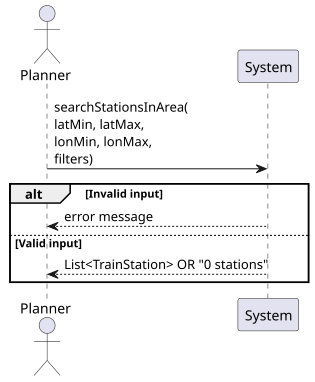

# USEI08 — Search by Geographical Area

## 1. Requirements Engineering

### 1.1. User Story Description

Planners need to search for railway stations within specific **geographical areas** (rectangular regions defined by latitude and longitude bounds). The system must leverage the BST/AVL index structures created in **USEI06** to perform efficient spatial queries that return stations located within a given geographical bounding box.

Unlike USEI06 which focuses on time-zone-based queries, USEI08 enables:
- **Geographical area searches** using latitude and longitude ranges
- **Rectangular bounding box queries** (minLat, maxLat, minLon, maxLon)
- **Filtering and sorting** results by country or time-zone group
- **Efficient range queries** on the latitude and longitude index trees

Since the dataset contains ~64k stations across Europe, sequential scans are too slow. The indexed structures must support logarithmic-time range queries.

**User Story:**
> As a planner, I want to search for stations within a specific geographical area (defined by latitude and longitude bounds), using the indexed structures from USEI06, so I can efficiently identify all stations located in a rectangular region of interest without scanning the entire dataset.

---

### 1.2. Customer Specifications and Clarifications

**From the specifications document:**

> Geographical area searches are defined by a **rectangular bounding box** with:
> - Minimum and maximum **latitude** bounds (`minLat`, `maxLat`)
> - Minimum and maximum **longitude** bounds (`minLon`, `maxLon`)

> A station is included in the results if:
> - `minLat ≤ station.latitude ≤ maxLat` AND
> - `minLon ≤ station.longitude ≤ maxLon`

> The search must use the **latitude and longitude BST/AVL trees** from USEI06 to perform efficient range queries.

> Results must be sortable by:
> - Latitude ASC/DESC
> - Longitude ASC/DESC
> - Country ASC, then station name ASC
> - Time-zone group ASC, then country ASC, then name ASC

> Multiple stations may share the same coordinates; all must be included in results.

**From client clarifications:**

> **Q:** How is the geographical area defined?  
> **A:** As a rectangular bounding box: `(minLat, maxLat, minLon, maxLon)`. Example: stations in Portugal could use `minLat=36.0, maxLat=42.2, minLon=-9.5, maxLon=-6.2`.

> **Q:** What happens if the bounding box crosses the -180/180 longitude boundary?  
> **A:** In this version, assume bounding boxes do not cross the antimeridian. For crossing cases, split into two queries.

> **Q:** How should results be sorted by default?  
> **A:** By latitude ASC, then longitude ASC, then country ASC, then station name ASC.

> **Q:** Can I filter results by country or time-zone after the geographical search?  
> **A:** Yes. The system must support post-filtering of geographical results by country and/or time-zone group.

> **Q:** What if no stations are found in the area?  
> **A:** Return an empty list with a clear message: "No stations found in the specified geographical area."

---

### 1.3. Acceptance Criteria

| ID | Requirement |
|----|-------------|
| **AC0** | The system must reuse the BST/AVL index structures (latitude tree, longitude tree, time-zone tree) created in **USEI06**. |
| **AC1** | Geographical area searches must accept four parameters: `minLat`, `maxLat`, `minLon`, `maxLon` (all doubles). |
| **AC2** | The search must return all stations where: `minLat ≤ latitude ≤ maxLat` AND `minLon ≤ longitude ≤ maxLon`. |
| **AC3** | The search algorithm must leverage the latitude and longitude trees for efficient range queries (O(log n + k) where k is the number of results). |
| **AC4** | Results must be sortable by latitude ASC/DESC, longitude ASC/DESC, country ASC, or time-zone group ASC. |
| **AC5** | When sorting by default (latitude ASC → longitude ASC), stations must be deterministically ordered. |
| **AC6** | The system must support optional filtering of geographical results by `country` (case-insensitive) and/or `timeZoneGroup`. |
| **AC7** | If no stations match the geographical area, return an empty list with message: "No stations found in the specified geographical area." |
| **AC8** | Boundary validation: `minLat ≤ maxLat` and `minLon ≤ maxLon` must be enforced. Invalid bounds return an error. |
| **AC9** | Tests must validate: correct range query behavior, sorting correctness, filtering by country/TZ, edge cases (empty area, single point, boundary conditions). |

---

### 1.4. Found Out Dependencies

**Prerequisites:**
- **USEI06** — Time-Zone Index and Windowed Queries: The BST/AVL trees for latitude, longitude, and time-zone must already be constructed and populated.

**Uses:**
- **Latitude BST/AVL Tree** — for efficient latitude range queries
- **Longitude BST/AVL Tree** — for efficient longitude range queries
- **Time-Zone BST/AVL Tree** — for optional post-filtering by time-zone group

**Does NOT:**
- Modify station data or index structures (read-only queries)
- Create new index structures (reuses existing ones)

**Interacts with:**
- **USEI06** — provides the index structures
- **USEI09–USEI10** — future spatial queries (e.g., nearest neighbor, distance-based searches)

---

### 1.5. Input and Output Data

#### Input Data:

**Query Parameters:**
- `minLat` (double) — minimum latitude bound ∈ [-90, 90]
- `maxLat` (double) — maximum latitude bound ∈ [-90, 90]
- `minLon` (double) — minimum longitude bound ∈ [-180, 180]
- `maxLon` (double) — maximum longitude bound ∈ [-180, 180]
- `sortBy` (optional) — sorting criterion: `"LATITUDE"`, `"LONGITUDE"`, `"COUNTRY"`, `"TIMEZONE"` (default: `"LATITUDE"`)
- `sortOrder` (optional) — `"ASC"` or `"DESC"` (default: `"ASC"`)
- `filterCountry` (optional) — filter results by country name (case-insensitive)
- `filterTimeZone` (optional) — filter results by time-zone group (case-insensitive)

**Index Data (from USEI06):**
- Pre-built BST/AVL trees indexing stations by latitude, longitude, and time-zone group.

#### Output Data:

**Query Results:**
- List of `Station` objects (or references) matching the geographical area.

**Each Station object contains:**
- `stationId` (if applicable)
- `name` (String)
- `country` (String)
- `timeZoneGroup` (String)
- `latitude` (double)
- `longitude` (double)

**Result Format:**
- Sorted collection (e.g., `List<Station>`) ordered according to `sortBy` and `sortOrder`
- If empty: message "No stations found in the specified geographical area."

**Example Query:**
```
Input: minLat=40.0, maxLat=42.0, minLon=-9.0, maxLon=-6.0
       filterCountry="Portugal", sortBy="LATITUDE", sortOrder="ASC"
Output: List of stations in Portugal's mainland region, sorted by latitude ascending
```

---

### 1.6. System Sequence Diagram (SSD)



---

### 1.7. Other Relevant Remarks

**Algorithm Design:**
- Use **range queries** on the latitude and longitude trees to find candidate stations.
- Perform **intersection** of latitude and longitude results to get stations within the bounding box.
- Optimize by querying the smaller result set first (if lat range has fewer results, start there).

**Performance Requirements:**
- Range queries must be **O(log n + k)** where n is the number of stations and k is the number of results.
- For empty or very large bounding boxes, the algorithm should still perform efficiently.
- Memory usage must be minimized (store references, not copies).

**Implementation Constraints:**
- Must use **class-developed BST/AVL trees** from USEI06 (no Java built-in TreeMap or TreeSet).
- No Java Stream API allowed — use loops, conditionals, and collections.
- Sorting must be implemented using the tree structures or primitive sorting algorithms.

**Testing Requirements:**
- **TDD mandatory** — write tests before implementation.
- Test cases must cover:
  - Normal geographical area queries
  - Edge cases: single point, empty area, boundary conditions
  - Sorting by different criteria
  - Filtering by country and time-zone
  - Invalid input handling (e.g., minLat > maxLat)
  - Performance with large result sets
- **Code coverage ≥ 80%** (JaCoCo verification).

**Error Handling:**
- Invalid bounding box (minLat > maxLat or minLon > maxLon) → throw `IllegalArgumentException`
- Invalid latitude/longitude values (outside [-90,90] or [-180,180]) → throw `IllegalArgumentException`
- Empty index trees → return empty list with appropriate message

