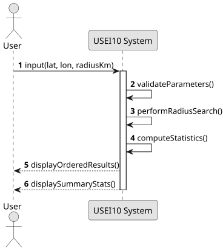

# USEI10 — Queries for locating facilities within a specific radius.

## 1. Requirements Engineering

### 1.1. User Story Description

To support route planning and intermodal logistics optimization, the system must provide efficient nearest-facility 
search capabilities over the indexed dataset of railway stations.    
This functionality allows planners to quickly identify the closest facility to another facility, enabling cost-efficient
route combinations.

**User Story:**
> As a planner, I want to query the nearest facility (station) to a given location or reference node, so that I can 
> efficiently determine intermodal transfer points and optimize transportation routes.
---

### 1.2. Customer Specifications and Clarifications

**From the specifications document:**

> The query must allow searching for facilities within a radius of a target (lat, lon)
  
> The search must rely on spatial indexes (KD-Trees or equivalent).  
A sequential scan through all facilities is not acceptable.

> Distance must be computed using the Haversine formula.  
Results must include:
    - Name
    - Calculated distance (in km)
    - Country
    - isCity

**From client clarifications:**

> **Q:**
> **A:**

---

### 1.3. Acceptance Criteria

| ID      | Requirement                                                                                                        |
|---------|--------------------------------------------------------------------------------------------------------------------|
| **AC0** | The dataset of facilities (stations) must be pre-loaded and indexed using KD-Trees .                               |
| **AC1** | The facilities must be determined using a valid geographic distance function (Haversine).                          |
| **AC2** | The function should return details of the facilities within the radius and the calculated distances in kilometers. |
| **AC3** | Queries must execute in logarithmic or near-logarithmic time relative to dataset size.                             |
| **AC6** | The system must support point-to-point (lat/lon).                                                                  |
| **AC7** | Unit tests must validate correctness of results, ordering, and computational accuracy of distance values.          |

---

### 1.4. Found Out Dependencies

- Depends on the KD-Tree and index structures built in:
    - USEI07 — KD-Tree Construction for spatial search

- Uses validated datasets for:
    - Stations (`train_stations_europe.csv`)
---

### 1.5. Input and Output Data

#### Input Data:
| Parameter   | Description                               |
|-------------|-------------------------------------------|
| `latitude`  | Latitude of the reference                 |
| `longitude` | Longitude of the reference point          |
| `radius`    | maximum distance from the reference point |

#### Output Data:
| Field        | Description                                       |
|--------------|---------------------------------------------------|
| `name`       | Facility name                                     |
| `distanceKm` | Calculated distance from the reference point (km) |
| `country`    | Country name                                      |
| `isCity`     | The facility is a city or not                     |

---

### 1.6. System Sequence Diagram (SSD)

---

### 1.7. Other Relevant Remarks

- The KD-Tree structure must store references to facility objects for spatial efficiency and fast traversal.

- Distance computations should rely on double-precision arithmetic to avoid rounding errors on large distances.

- The algorithm must handle:
    - Facilities with identical coordinates (tie-breaking by name ASC)
    - Missing or invalid coordinates (discarded during data validation)
    - Empty datasets gracefully (return empty result)

- Performance goals:
    - O(log n) average query time for nearest search
    - Scalable to datasets containing tens of thousands of facilities

- Implementation must follow deterministic traversal rules to ensure reproducible query results.

- Must support unit and integration tests validating:
    - Spatial correctness (distance ordering)
    - Empty or invalid inputs