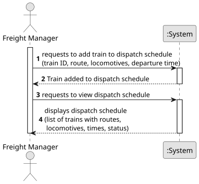

# USLP07 — Train Scheduler for Dispatching Multiple Trains

## 1. Requirements Engineering

### 1.1. User Story Description

As a **Freight Manager**, I want to use a scheduler that allows me to dispatch a list of trains. Each train has an associated route that can be simple or complex, so I can efficiently plan and coordinate multiple freight operations simultaneously.

The scheduler must support:
- Creating and managing a list of trains to be dispatched
- Associating each train with a route (simple or complex)
- Validating routes before dispatch
- Displaying the scheduled trains with their routes and estimated departure/arrival times

---

### 1.2. Customer Specifications and Clarifications

**From the specifications document:**

> A **route** defines the path a train follows from origin to destination.
>
> Routes can be:
> - **Simple route**: Direct connection between two stations (origin → destination)
> - **Complex route**: Multiple intermediate stations (origin → station1 → station2 → ... → destination)
>
> Each train must have:
> - A unique identifier
> - An assigned locomotive (or set of locomotives)
> - A route (simple or complex)
> - A scheduled departure time
>
> The scheduler must validate that:
> - All stations in the route exist and are connected
> - The locomotive(s) are compatible with the route's gauge requirements
> - There are no scheduling conflicts (overlapping routes on the same line segments at the same time)

**From the client clarifications:**

> **Q:** What defines a simple route versus a complex route?  
> **A:** A simple route has exactly two stations (origin and destination) with a direct connection. A complex route has three or more stations with intermediate stops.

> **Q:** Can a train have multiple locomotives?  
> **A:** Yes, multiple locomotives can be coupled together to provide sufficient power for the train.

> **Q:** What happens if a route validation fails?  
> **A:** The train should not be added to the dispatch list, and an error message should be displayed indicating the validation failure reason.

> **Q:** Should the scheduler prevent conflicts automatically?  
> **A:** In this version, the scheduler should warn about potential conflicts but allows the Freight Manager to make the final decision.

> **Q:** How is estimated travel time calculated for complex routes?  
> **A:** The system should sum the travel times between consecutive stations in the route using the functionality from **USLP03**.

---

### 1.3. Acceptance Criteria

| ID | Requirement |
|----|-------------|
| **AC1** | The system must allow the Freight Manager to create a list of trains to be dispatched. |
| **AC2** | Each train must be associated with a route (simple or complex). |
| **AC3** | For simple routes, the system must allow selecting two stations (origin and destination) that are directly connected. |
| **AC4** | For complex routes, the system must allow adding multiple intermediate stations between origin and destination. |
| **AC5** | Each train must be assigned at least one locomotive compatible with the route's gauge requirements. |
| **AC6** | The system must validate that all stations in a route exist and are properly connected (using line segments). |
| **AC7** | The system must calculate and display estimated travel time for each route (reusing USLP03 functionality). |
| **AC8** | The system must display the complete dispatch schedule showing: train ID, route (with all stations), locomotive(s), departure time, estimated arrival time. |
| **AC9** | The system must warn about potential scheduling conflicts (if multiple trains use the same line segment at overlapping times). |
| **AC10** | Invalid trains (failed validation) must not be added to the dispatch list, and appropriate error messages must be shown. |

---

### 1.4. Found Out Dependencies

**Prerequisites:**
- **USLP03** — Calculate estimated travel time between two stations: This functionality must be reused to calculate travel times for each segment in a route.

**Uses:**
- Station data (from database or domain model)
- Locomotive data (from domain model)
- Line segment connectivity information
- Route validation logic

**Interacts with:**
- Domain model entities: `Train`, `Route`, `Station`, `Locomotive`, `LineSegment`
- USLP03 functionality for travel time estimation

---

### 1.5. Input and Output Data

#### Input Data:

**For each train to be dispatched:**
- `trainId` (String) — unique identifier for the train
- `routeType` (String) — `"SIMPLE"` or `"COMPLEX"`
- `originStation` (String) — starting station name or ID
- `destinationStation` (String) — final destination station name or ID
- `intermediateStations` (List<String>, optional) — list of intermediate stations (only for complex routes)
- `locomotiveIds` (List<String>) — one or more locomotive identifiers
- `departureTime` (LocalDateTime or String) — scheduled departure time

**Route Configuration:**
- For simple routes: origin → destination
- For complex routes: origin → [intermediate1, intermediate2, ...] → destination

#### Output Data:

**Dispatch Schedule:**
- List of scheduled trains with:
  - `trainId`
  - `route` (complete path with all stations)
  - `locomotives` (list of assigned locomotives)
  - `departureTime`
  - `estimatedArrivalTime` (calculated using USLP03)
  - `totalEstimatedTravelTime`
  - `status` (VALIDATED, CONFLICT_WARNING, INVALID)

**Validation Messages:**
- Success: "Train [trainId] added to dispatch schedule."
- Error: "Train [trainId] validation failed: [reason]"
- Warning: "Potential scheduling conflict detected for train [trainId]"

**Example Output:**
```
Dispatch Schedule:
- Train T001: Porto → Lisboa (Simple)
  Locomotives: L123, L124
  Departure: 2025-10-15 08:00
  Estimated Arrival: 2025-10-15 12:30
  Travel Time: 4h 30m
  Status: VALIDATED

- Train T002: Braga → Porto → Aveiro → Coimbra (Complex)
  Locomotives: L125
  Departure: 2025-10-15 09:00
  Estimated Arrival: 2025-10-15 14:15
  Travel Time: 5h 15m
  Status: CONFLICT_WARNING
```

---

### 1.6. System Sequence Diagram (SSD)



---

### 1.7. Other Relevant Remarks

**Route Validation:**
- Simple routes: Check if origin and destination are directly connected via line segments.
- Complex routes: Check if each consecutive pair of stations (origin→station1, station1→station2, ..., stationN→destination) is connected.

**Travel Time Calculation:**
- For simple routes: Use USLP03 directly (origin → destination).
- For complex routes: Sum travel times for each segment:
  - origin → intermediate1
  - intermediate1 → intermediate2
  - ...
  - intermediateN → destination

**Scheduling Conflicts:**
- Check if any two trains use the same line segment during overlapping time windows.
- Warning only (not blocking) — Freight Manager decides whether to proceed.

**Implementation Notes:**
- Use domain model classes from USLP01.
- Reuse travel time calculation logic from USLP03.
- Maintain a collection (List) of scheduled trains.
- Display schedule in a clear, formatted table or list.

**Error Handling:**
- Invalid station names → display error and do not add train.
- Non-existent route segments → display error indicating which segment is missing.
- Incompatible locomotive gauge → display error and do not add train.
- Invalid departure time format → prompt for correct format.

