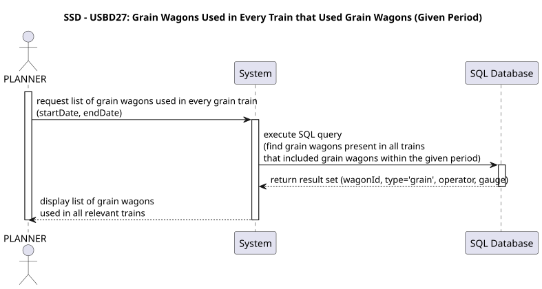

# USBD27 — List Grain Wagons Used in Every Train that Used Grain Wagons (Given Period)

## 1. Requirements Engineering

### 1.1. User Story Description

To analyze specialized wagon utilization and operational consistency, the system must identify grain wagons that were 
used in every train where grain wagons appeared during a specified time period.  
This information allows planners to assess which wagons are systematically employed in all grain-related operations, 
supporting maintenance prioritization and resource allocation.

**User Story:**
> As a planner, I want a list of grain wagons that were used in every train that used grain wagons during a given 
> period, so that I can identify wagons with high operational consistency and critical usage in grain transport.
---

### 1.2. Customer Specifications and Clarifications

**From the specifications document:**

> The query must return only those wagons of type ‘grain’ that have participated in all trains (within a given period) 
> that included at least one grain wagon.

> The comparison is limited to trains whose scheduled or executed time intersects the specified period.

> Wagons not classified as grain type must be ignored.

> The query must be implemented as a PL/SQL function returning a SYS_REFCURSOR.

**From client clarifications:**

> **Q:**   
> **A:** 

---

### 1.3. Acceptance Criteria

| ID      | Description                                                                                                                    |
|---------|--------------------------------------------------------------------------------------------------------------------------------|
| **AC1** | The query must return only grain wagons that were used in every train containing at least one grain wagon in the given period. |
| **AC2** | The query must support configurable date range parameters (`startDate`, `endDate`).                                            |
| **AC3** | The result must include: `wagonId`, wagon type, operator, and gauge.                                                           |
| **AC4** | The solution must be implemented as a **PL/SQL function returning a `SYS_REFCURSOR`**.                                         |
| **AC5** | If no wagons meet the condition, the function must return an empty result set (not NULL).                                      |
| **AC6** | Input validation must handle invalid or reversed date ranges gracefully.                                                       |

---

### 1.4. Found Out Dependencies

This user story depends on:

- **Rolling Stock Model**:
    - Must include wagon attributes: type (grain), operator, and gauge.
- **Train Composition Model**:
    - Mapping between wagons and trains must be correctly modeled.
    - Relationship between train IDs and wagon IDs.
- **Train Schedule Model**:
    - Each train must include start and end timestamps to allow filtering by date range.

It interacts with:
- Operational reporting modules for planners
- Data analytics modules focused on wagon utilization

---

### 1.5. Input and Output Data

#### Input Parameters:
| Parameter   | Type | Description                        |
|-------------|------|------------------------------------|
| `startDate` | DATE | Lower bound of the analysis period |
| `endDate`   | DATE | Upper bound of the analysis period |

#### Output Data (Query Result):
| Field     | Description                             |
|-----------|-----------------------------------------|
| wagonId   | Unique identifier of the wagon          |
| wagonType | Should always be `grain`                |
| operator  | Company that owns or operates the wagon |
| gauge     | Track gauge compatible with the wagon   |

---

### 1.6. System Sequence Diagram (SSD)

---

### 1.7. Other Relevant Remarks

- The logic must ensure that a wagon is present in all grain-related trains within the defined date range.
    - Example: If 5 trains carried grain wagons, only wagons appearing in all 5 of them are returned.
- Date range filtering must consider train departure or arrival timestamps that intersect the interval.
- Must handle:
    - Wagons classified as grain but not used in the period → excluded.
    - Trains without grain wagons → ignored from comparison.
- Performance must be optimized for datasets with many train–wagon associations.
- This query can be implemented using set intersection logic or grouping and counting by wagon ID and train occurrences.

---
