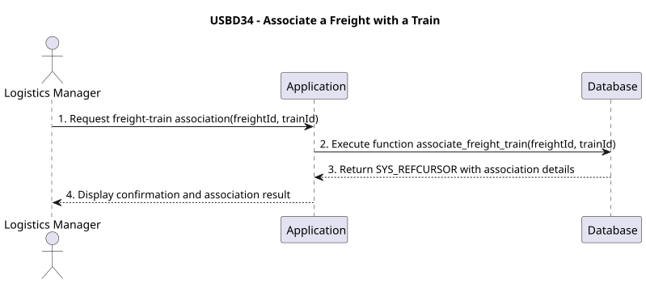

# USBD34 - Associate a Freight with a Train

## 1. Requirements Engineering

### 1.1. User Story Description

As a **logistics manager**, I want to **associate a freight with a train**, so that the freight can be scheduled, transported, and tracked during railway operations.

---

### 1.2. Customer Specifications and Clarifications

**From the specifications document:**

> Each user story in the Business Data sprint must be implemented as a PL/SQL function returning a SYS_REFCURSOR.
> Every query must return at least one record. 
> Data imported in USBD23 must be reused whenever possible.

---

### 1.3. Acceptance Criteria

- **AC1:** The system must create an association between a freight and a train.
- **AC2:** The function must verify that both the freight and the train exist.
- **AC3:** The freight must not already be assigned to another train.
- **AC4:** The function must return a **SYS_REFCURSOR** containing:
    - Freight ID
    - Freight description (if stored)
    - Train ID
    - Train designation or code
- **AC5:** Data integrity and foreign key relationships must be enforced.
- **AC6:** The function must not allow duplicate assignments of the same freight.

---

### 1.4. Found out Dependencies

This user story depends on:
- USBD23 for all imported base data (freight list, train list).
- The following tables:
    - `freight` 
    - `train` 

---

### 1.5. Input and Output Data

**Input Data:**

- Freight identifier
- Train identifier

**Output Data:**

- A **SYS_REFCURSOR** containing:
    - Freight ID
    - Freight description (optional, depending on schema)
    - Train ID
    - Train designation

---

### 1.6. System Sequence Diagram (SSD)



---

### 1.7. Other Relevant Remarks

- The function must ensure that:
  - Freight exists
  - Train exists
  - Freight is not already assigned
- Implementation should handle errors and raise exceptions when necessary.
- Suggested PL/SQL function signature:

```sql
FUNCTION associate_freight_train (
  p_freight_id IN NUMBER,   
  p_train_id   IN NUMBER
) RETURN SYS_REFCURSOR;