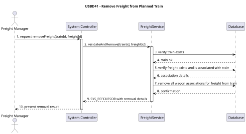

# USBD41 - Remove a Freight from a Planned Train

## 1. Requirements Engineering

### 1.1. User Story Description

As a Freight Manager, I want to remove a freight from a planned train, so that its wagons are no longer associated 
with that train.
---

### 1.2. Customer Specifications and Clarifications

**From the specifications document:**

> All commits for these US are individual; each US is assessed independently.
> US must be implemented as a PL/SQL function.
> Functions must be fully testable (anonymous block required).
> SYSDATE should not be used in functions (to keep tests deterministic).
> A freight can only be removed from a train if it is currently associated with that train.
> Removing a freight implicitly removes the association of all its wagons and locomotives with that train.
> The operation must ensure data integrity, consistent with all database rules.
> The train must remain in a valid state after removal (e.g., not violating maximum length constraints — although reducing length is always safe).

---

### 1.3. Acceptance Criteria

- **AC1:** The freight must be successfully removed from the specified planned train.
- **AC2:** All wagons and locomotives associated with that freight must be removed from the train.
- **AC3:** The function must validate that:
    - the train exists;
    - the freight exists;
    - the freight is currently associated with the train.
- **AC4:** The function must maintain referential and business rule integrity.
- **AC5:** The function must return a SYS_REFCURSOR confirming the removal result (mandatory for Sprint 3 USBD functions).
- **AC6:** Returned records must include at least:
    - Train ID,
    - Freight ID,
    - List of wagons removed,
    - Status or confirmation message.
- **AC7:** If the freight is not associated with the train, the function must return an empty result or an informative 
cursor (but no exceptions unless logically invalid).

---

### 1.4. Found out Dependencies

-**USBD31** – Updated relational model must include freight–train relationship structures
- Database tables needed:
    - train
    - freight
    - wagon
    - associative table like train_wagon
---

### 1.5. Input and Output Data

**Input Data:**

- Freight identifier
- Train identifier

**Output Data:**

- A **SYS_REFCURSOR** containing:
    - Freight ID
    - Train ID
    - Wagon IDs that were removed

---

### 1.6. System Sequence Diagram (SSD)

---

### 1.7. Other Relevant Remarks

- A PL/SQL function must be created (mandatory for Sprint 3).
- An anonymous PL/SQL block must be provided to fully test the function.
- The function must not use SYSDATE to avoid non-deterministic behaviour during tests.
- All business validations must occur before any modification to the database.
- Error handling should be deterministic and meaningful.
- Implementation should handle errors and raise exceptions when necessary.
- Suggested PL/SQL function signature: