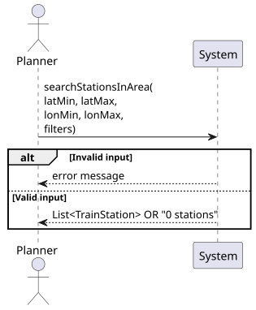

# USEI08 — Search by Geographical Area

## 1. Requirements Engineering

### 1.1. User Story Description

Planners need to search for railway stations within specific **geographical areas** defined by latitude and longitude.  
To support efficient spatial queries over ~62k European stations, the system must use a **2D KD-tree** (not the structures from USEI06), enabling pruning during range search and avoiding full dataset scans.

**User Story:**
> As a planner, I want to query a 2D KD-tree for all stations in a latitude/longitude range, with optional filters, so I can extract relevant stations quickly.

USEI08 expands previous work by enabling:
- **Geographical bounding box queries**
- **Efficient 2D spatial search using KD-tree pruning**
- **Optional filters**: `isCity`, `isMainStation`, and `country`
- **Complete result listing for interactive queries**
- **Sample predefined queries** demonstrating usage
- **Temporal complexity analysis**

---

### 1.2. Customer Specifications and Clarifications

**From the specification document:**

> Search region is a rectangular bounding box defined by:
> - `latMin`, `latMax` (latitude range)
> - `lonMin`, `lonMax` (longitude range)

> A station matches if:  
> `latMin ≤ station.lat ≤ latMax`  
> AND  
> `lonMin ≤ station.lon ≤ lonMax`

> The search must use a **2D spatial indexing structure** (KD-tree) to prune branches outside the search region.

**Optional filters:**
- `isCity` → true / false / any
- `isMainStation` → true / false / any
- `country` → PT / ES / ALL

**Clarifications:**
- Bounding boxes do **not** cross the antimeridian (no wrap-around).
- Sorting is **not required** for USEI08; listing order is based on KD-tree traversal.
- UI prompts are not part of the system behavior (excluded from SSD).
- KD-tree must contain **full TrainStation objects**, not only coordinates.
- All coordinates must be validated (`lat ∈ [-90,90]`, `lon ∈ [-180,180]`).
- If no stations match, return **0 results**.

---

### 1.3. Acceptance Criteria

| ID | Requirement |
|----|-------------|
| **AC1** | The system must build a **2D KD-tree** containing all stations from the CSV. |
| **AC2** | Inputs: `latMin`, `latMax`, `lonMin`, `lonMax` must be validated. |
| **AC3** | A station matches if inside the bounding box. |
| **AC4** | Optional filters: `isCity`, `isMainStation`, `country`. |
| **AC5** | Interactive query must display **all stations found**. |
| **AC6** | Sample queries must display up to 10 stations + “…and X more”. |
| **AC7** | Must print KD-tree temporal complexity analysis. |
| **AC8** | Invalid ranges must be rejected (`latMin > latMax`, etc.). |
| **AC9** | JUnit tests must load real CSV data (no mock data). |

---

### 1.4. Found Out Dependencies

**Uses:**
- `TrainStation`
- `TrainStationLoader`
- `KDTreeStations`
- `USEI08Controller`
- `USEI08UI`

**Does not use:**
- USEI06 AVL/BST structures
- USEI07 TwoDTree (cannot be modified, incomplete data)

**Interacts with:**
- Console UI (only for input prompts; not part of system requirements)

---

### 1.5. Input and Output Data

#### Input Data

**Query Parameters:**
- `latMin` (double) — ∈ [-90, 90]
- `latMax` (double) — ∈ [-90, 90]
- `lonMin` (double) — ∈ [-180, 180]
- `lonMax` (double) — ∈ [-180, 180]
- Optional filters:
  - `isCity` → Boolean or null
  - `isMainStation` → Boolean or null
  - `country` → `"PT"`, `"ES"`, or null

#### Output Data

- **List\<TrainStation\>** inside the bounding box and satisfying filters
- For interactive query: **all stations printed**
- For sample queries: up to 10 stations
- Complexity text block printed

**Example:**

```
Input:
  latMin = 37
  latMax = 40
  lonMin = -9
  lonMax = -6
  isCity = true
  country = PT

Output:
  34 matching stations printed in full
```

---

### 1.6. System Sequence Diagram (SSD)



---

### 1.7. Other Relevant Remarks

#### Algorithm Design
- KD-tree insertion: alternating dimension (lon/lat)
- Range search with pruning:
  - if splitting by longitude → prune subtrees outside `[lonMin, lonMax]`
  - if splitting by latitude → prune subtrees outside `[latMin, latMax]`

#### Performance
- Build: **O(N log N)**
- Range search (average): **O(k + √N)**
- Worst case: **O(N)**
- Filter application: **O(k)**

#### Testing Requirements
- Must load real CSV dataset
- Cover cases:
  - Empty results
  - Large bounding box
  - Single-point bounding box
  - Country filter
  - isCity/isMainStation filters
  - Edge values (±90, ±180)

#### Constraints
- Cannot modify professor’s AVL/BST/TwoDTree classes
- Must use project-provided TrainStation and loader
- No Streams API (loop-based implementation expected)

