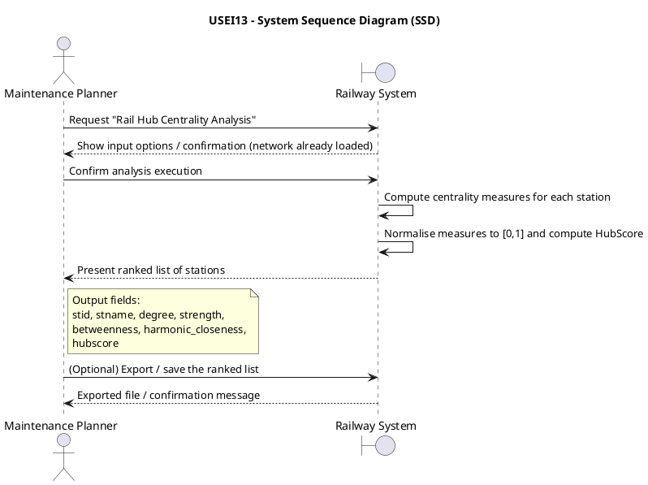

# USEI13 — Rail Hub Centrality Analysis

## 1. Requirements Engineering

### 1.1. User Story Description

**Context:**
Rail operations depend on a small set of hub stations that concentrate transfers, connect regions, and act as chokepoints. Identifying these hubs quantitatively helps with capacity planning, robustness (where failures have a significant impact), and prioritizing upgrades.

**User Story:**
> As a maintenance planner, I want to compute centrality measures for each station (betweenness, harmonic closeness, and strength/degree), combine them into a composite **HubScore** (normalised and weighted), and rank the network’s hubs for decision-making.

---

### 1.2. Customer Specifications and Clarifications

- **Graph Model:**
  - The railway network must be represented as a graph where:
    - Vertices represent stations (nodes).
    - Edges represent rail connections between stations.
    - Edges are weighted by **distance** (km) for shortest-path computations.

- **Centrality Measures:**
  - The system must compute, for each station:
    - **Degree**: number of adjacent stations (direct connections).
    - **Strength**: a measure of direct connectivity based on incident edges (see clarification below).
    - **Betweenness centrality**: based on shortest paths between all station pairs.
    - **Harmonic closeness**: accessibility measure based on shortest-path distances.

- **Strength Clarification (Implementation Choice):**
  - Strength must be defined consistently for all stations.
  - Recommended definition:
    - `strength = sum(1 / distance(edge))` over all incident edges.
  - If another definition is used (e.g., `sum(distance)` or `sum(capacity)`), it must be applied consistently and documented.

- **Normalisation:**
  - All metric scores must be **normalised to [0,1] per component** before combining.
  - Normalisation must be performed using a deterministic strategy (e.g., Min–Max normalisation).
  - If a component has `max == min`, the normalised value for that component must be set to `0` for all stations (to avoid division by zero).

- **HubScore:**
  - The composite score must be computed using the following weights:
    - `hubscore = 0.35 * betwNorm + 0.35 * harmonicClosenessNorm + 0.30 * strengthNorm`

- **Ranking / Export:**
  - The system must return a ranked list of all stations by descending `hubscore`.
  - The output must be exportable or printable in a tabular format.

- **Complexity:**
  - A temporal complexity analysis is required.

---

### 1.3. Acceptance Criteria

| ID | Requirement |
|----|-------------|
| **AC1** | The system must compute **degree** and **strength** for every station in the network graph. |
| **AC2** | The system must compute **betweenness centrality** based on shortest paths over edge **distance**. |
| **AC3** | The system must compute **harmonic closeness** using shortest-path distances. |
| **AC4** | All computed metrics must be normalised to **[0,1] per component** before combination. |
| **AC5** | The system must compute `hubscore` using the specified weighted formula and return it for every station. |
| **AC6** | The system must return a list with the fields: `stid, stname, degree, strength, betweenness, harmonic_closeness, hubscore`. |
| **AC7** | The returned list must be ranked by `hubscore` in descending order. |
| **AC8** | The solution must include a temporal complexity analysis (Big-O). |


### 1.3.1. System Sequence Diagram (SSD)

The SSD describes the interaction between the user and the system as a black box (no internal function calls).




---

### 1.4. Found-Out Dependencies

- **Graph Implementation:** depends on the graph classes used in ESINF (vertices, edges, adjacency, and shortest-path support).
- **Shortest-Path Routine:** required for betweenness and harmonic closeness (must support weighted edges by distance).
- **Dataset / Network:** intended to be tested using the Belgian rail network dataset used in Sprint 3.

---

### 1.5. Input and Output Data

**Input:**
- A Railway Network Graph:
  - Station nodes containing at least `stid` and `stname`.
  - Edges containing at least `distance` (km).

**Output:**
- A ranked list (table/collection) containing:
  - `stid, stname, degree, strength, betweenness, harmonic_closeness, hubscore`
- Temporal analysis (Big-O) of the implemented algorithm.

---

## 2. Design & Algorithm

### 2.1. Algorithm Overview

The centrality analysis requires:
1. **Local Connectivity Metrics** (degree, strength).
2. **All-Pairs Shortest-Path Information** (for betweenness and harmonic closeness).
3. **Normalisation** of each metric to [0,1].
4. **HubScore** calculation and ranking.

A practical approach:
- Compute degree/strength by iterating adjacency lists.
- Compute shortest paths from each node (e.g., Dijkstra from every node for weighted graphs).
- Use a standard betweenness method (e.g., Brandes algorithm for weighted graphs).
- Compute harmonic closeness as the sum of inverse distances to reachable nodes.

---

### 2.2. Pseudocode

```java
List<HubCentralityRow> computeHubCentrality(Graph g) {
  // 1) Degree + Strength
  for (Vertex v : g.vertices()) {
    degree[v] = g.adjacentVertices(v).size();
    strength[v] = sum(1.0 / distance(v, u) for each adjacent u); // or chosen definition
  }

  // 2) Betweenness + Harmonic Closeness (weighted)
  // Use Brandes for weighted graphs, which internally runs Dijkstra per source
  betweenness = brandesWeightedBetweenness(g, edgeWeight = distance);

  for (Vertex s : g.vertices()) {
    dist = dijkstra(g, s, edgeWeight = distance);
    harmonic[s] = sum(1.0 / dist[t] for all t != s where dist[t] < INF);
  }

  // 3) Normalise components to [0,1]
  betwNorm = minMaxNorm(betweenness);
  harmonicNorm = minMaxNorm(harmonic);
  strengthNorm = minMaxNorm(strength);

  // 4) HubScore
  for (Vertex v : g.vertices()) {
    hubscore[v] = 0.35*betwNorm[v] + 0.35*harmonicNorm[v] + 0.30*strengthNorm[v];
  }

  // 5) Build output rows and sort by hubscore desc
  rows = buildRows(stid, stname, degree, strength, betweenness, harmonic, hubscore);
  sort(rows, by hubscore desc, tie-breaker stid asc);
  return rows;
}
```

---

## 3. Temporal Analysis (Complexity)

Let:
- `V` be the number of stations (vertices),
- `E` be the number of connections (edges).

| Operation | Complexity | Notes |
|----------|------------|------|
| Degree/Strength | `O(V + E)` | Single pass over adjacency lists. |
| Dijkstra (single source) | `O((E + V) log V)` | With a binary heap priority queue. |
| Harmonic closeness (all sources) | `O(V (E + V) log V)` | Dijkstra from each vertex. |
| Betweenness (Brandes, weighted) | `O(V E log V)` | Weighted Brandes using Dijkstra per source. |
| Normalisation + sorting | `O(V log V)` | Normalisation is linear; sorting dominates. |
| **Total** | **`O(V E log V)`** | Dominated by weighted betweenness computation. |
