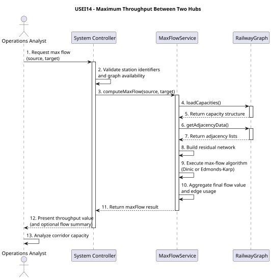

# USEI14 — Maximum Throughput Between Two Hubs

## 1. Requirements Engineering

### 1.1. User Story Description

Context: Railway corridors connecting major hubs often operate close to their maximum capacity. Each connection (edge) 
in the Belgian railway network includes a capacity value representing the maximum number of trains that can travel through 
that segment per planning day. To support operational planning and detect bottlenecks, analysts must compute the maximum
possible throughput between two stations.

**User Story:**
> As an operations analyst, I want to compute the maximum flow between two selected stations (source and sink), so that 
I can estimate the theoretical throughput of a corridor and identify potential bottlenecks.
---

### 1.2. Customer Specifications and Clarifications

- The railway network is represented as a **directed graph**, where:
    - Nodes = stations.
    - Edges = directed tracks with defined capacity. 
- The max-flow must compute the maximum number of trains per day that can travel from station source to station target.
- Edge capacities are non-negative.
- The algorithm must:
    - Support arbitrary source and target
    - Run deterministically
    - Return both the max flow value and optionally the flow assignment/edge usage
- Temporal complexity analysis must be included.
- If no path exists between the two stations, the max flow is 0.
- Negative capacities do not exist (unlike in USEI15 costs).

---

### 1.3. Acceptance Criteria

| ID | Requirement |
|----|-------------|
| **AC0** | Validate that the graph and capacities are correctly loaded. |
| **AC1** | Allow the user to select valid source and target stations. |
| **AC2** | Return the maximum flow value. |
| **AC3** | If requested, return or print the per-edge flow distribution. |
| **AC4** | If there is no path, return max flow = 0. |
| **AC5** | Provide temporal complexity analysis for the chosen algorithm. |
| **AC6** | The algorithm must be deterministic and reproducible. |

---

### 1.4. Found-Out Dependencies

- Requires the Belgian station graph (nodes, edges, capacities) loaded in memory..
- Depends on shortest-path and traversal utilities from graph classes.

---

### 1.5. Input and Output Data

**Input:** 
- `sourceStationId`
- `targetStationId`
- Directed graph with capacities: `capacity(u, v)`
**Output:** 
- `maxFlowValue`
- Optional: list of edges carrying nonzero flow (u → v: flow f)
---

### 1.6. System Sequence Diagram (SSD)

---