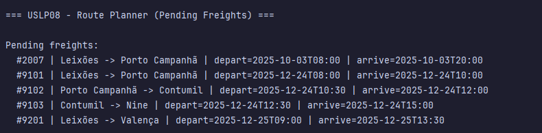
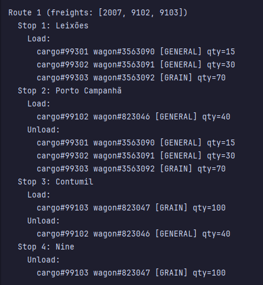
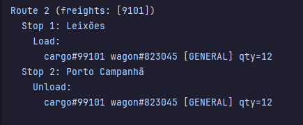
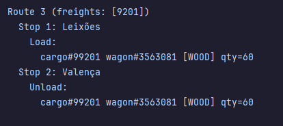

# USLP08 – Route Planner (Pending Freights)

## 1. Objective

The goal of **USLP08 – Route Planner (Pending Freights)** is to allow a **Freight Manager** to define and assign routes to **pending freights**, producing routes that can be **simple or complex**, and clearly presenting:

- The **sequence of stations** in each route
- The **cargos to be loaded and unloaded** at each station
- Routes built **only from pending freights**
- Data obtained exclusively via **PL/SQL functions**

This documentation demonstrates the correct behaviour of the user story through representative execution scenarios and outputs.

---

## 2. Acceptance Criteria

✔ A list with the **sequence of stations** is presented  
✔ **Cargos to load and unload** are shown per station  
✔ Routes may be **simple** (single freight) or **complex** (multiple freights chained)  
✔ Only **pending freights** are considered  
✔ The database is accessed **exclusively through PL/SQL functions**  
✔ The UI presents all results in a clear and readable way

---

## 3. Pending Freights Listing

When the Freight Manager selects **USLP08** from the Admin Menu, the system retrieves all pending freights using a PL/SQL function.

### Output

**Displayed pending freights:**
- `#2007 | Leixões → Porto Campanhã`
- `#9101 | Leixões → Porto Campanhã`
- `#9102 | Porto Campanhã → Contumil`
- `#9103 | Contumil → Nine`
- `#9201 | Leixões → Valença`

---

## 4. Scenario 1 – Complex Route (Multiple Freights)

In this scenario, the system automatically groups compatible pending freights into a **single complex route**, chaining them by matching destination and origin stations.

### Selected Freights
- `2007`
- `9102`
- `9103`

### Generated Route

#### Route Description

**Route 1 (freights: 2007, 9102, 9103)**

- **Stop 1 – Leixões**
    - Load:
        - cargo#99301 wagon#3563090 `[GENERAL]` qty=15
        - cargo#99302 wagon#3563091 `[GENERAL]` qty=30
        - cargo#99303 wagon#3563092 `[GRAIN]` qty=70

- **Stop 2 – Porto Campanhã**
    - Unload:
        - cargo#99301 wagon#3563090 `[GENERAL]` qty=15
        - cargo#99302 wagon#3563091 `[GENERAL]` qty=30
        - cargo#99303 wagon#3563092 `[GRAIN]` qty=70
    - Load:
        - cargo#99102 wagon#823046 `[GENERAL]` qty=40

- **Stop 3 – Contumil**
    - Unload:
        - cargo#99102 wagon#823046 `[GENERAL]` qty=40
    - Load:
        - cargo#99103 wagon#823047 `[GRAIN]` qty=100

- **Stop 4 – Nine**
    - Unload:
        - cargo#99103 wagon#823047 `[GRAIN]` qty=100

✔ Demonstrates a **complex route**  
✔ Multiple load/unload operations per station  
✔ Correct chaining of freights

---

## 5. Scenario 2 – Simple Route (Single Freight)

This scenario demonstrates a **simple route**, generated from a single pending freight.

### Selected Freight
- `9101`

### Generated Route

#### Route Description

**Route 2 (freights: 9101)**

- **Stop 1 – Leixões**
    - Load:
        - cargo#99101 wagon#823045 `[GENERAL]` qty=12

- **Stop 2 – Porto Campanhã**
    - Unload:
        - cargo#99101 wagon#823045 `[GENERAL]` qty=12

✔ Demonstrates a **simple route**  
✔ One load and one unload operation

---

## 6. Scenario 3 – Long Distance Simple Route

This scenario shows a simple route covering a **longer railway distance**, still respecting the same planning logic.

### Selected Freight
- `9201`

### Generated Route

#### Route Description

**Route 3 (freights: 9201)**

- **Stop 1 – Leixões**
    - Load:
        - cargo#99201 wagon#3563081 `[WOOD]` qty=60

- **Stop 2 – Valença**
    - Unload:
        - cargo#99201 wagon#3563081 `[WOOD]` qty=60

✔ Demonstrates long-distance routing  
✔ Clear load/unload semantics

---

## 7. Database Access Validation

All information displayed in the UI is retrieved using **PL/SQL functions**, including:

- Pending freights
- Cargo associated with each freight
- Wagon and cargo details

No direct table access is performed from Java code, fully complying with the architectural constraints defined for the project.

---

## 8. Conclusion

The **USLP08 – Route Planner (Pending Freights)**:

- Fully satisfies all **acceptance criteria**
- Correctly supports **simple and complex routes**
- Clearly presents **stations and cargo operations**
- Is fully testable and demonstrable **without executing the system live**
- Is consistent with the overall project architecture and UI standards

This documentation can be used directly during the project defense as functional proof of correctness.

---
