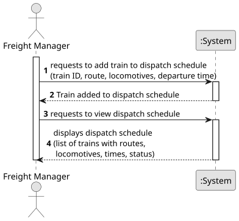

# USLP07 — Train Scheduler for Dispatching Multiple Trains

## 1. Requirements Engineering

### 1.1. User Story Description

As a **Freight Manager**, I want to use a scheduler that allows me to dispatch a list of trains. Each train has an associated route that can be simple or complex, so I can efficiently plan and coordinate multiple freight operations simultaneously.

The scheduler must support:
- Creating and managing a list of trains to be dispatched
- Associating each train with a route (simple or complex)
- Validating routes before dispatch
- Displaying the scheduled trains with their routes and estimated departure/arrival times

---

### 1.2. Customer Specifications and Clarifications

**From the specifications document:**

> A **route** defines the path a train follows from origin to destination.
>
> Routes can be:
> - **Simple route**: Direct connection between two stations (origin → destination)
> - **Complex route**: Multiple intermediate stations (origin → station1 → station2 → ... → destination)
>
> Each train must have:
> - A unique identifier
> - An assigned locomotive (or set of locomotives)
> - A route (simple or complex)
> - A scheduled departure time

> The system must compute **travel speed per line segment** based on:
> - the **segment speed limit**,
> - the **combined power of the locomotives**,
> - the **total train weight** (locomotives + wagons, loaded or empty).

> The scheduler must indicate **estimated passage times** for each station or relevant point along the route and must also compute crossing operations when necessary.

---

### Additional Clarifications (added for full alignment with the sprint requirement)

#### **Single-track line behaviour**
- A **single-track segment** cannot be occupied simultaneously by two trains in opposite directions.
- When two trains would conflict on a single-track segment, a **crossing** must be scheduled.
- A crossing may only occur at:
  - a **siding**, or
  - the **station immediately before** the conflicting segment.

#### **Crossing resolution**
- When a conflict is detected:
  - The scheduler must determine the correct crossing point.
  - One train may need to **wait**.
  - The waiting time must be **propagated forward**, adjusting all future passage times.
  - The system must record the crossing as a **Crossing Operation**.

#### **Passage Times**
For every train, the scheduler must compute:
- time of passage at each station,
- time of passage at sidings,
- estimated arrival time at final destination.

These outputs must be shown clearly in the final schedule.

---

### 1.3. Acceptance Criteria

| ID | Requirement |
|----|-------------|
| **AC1** | The system must allow the Freight Manager to create a list of trains to be dispatched. |
| **AC2** | Each train must be associated with a route (simple or complex). |
| **AC3** | For simple routes, the system must allow selecting two stations (origin and destination) that are directly connected. |
| **AC4** | For complex routes, the system must allow adding multiple intermediate stations between origin and destination. |
| **AC5** | Each train must be assigned at least one locomotive compatible with the route's gauge requirements. |
| **AC6** | The system must validate that all stations in a route exist and are properly connected (using line segments). |
| **AC7** | The system must calculate and display estimated travel time for each route (reusing USLP03 functionality). |
| **AC8** | The system must display the complete dispatch schedule showing: train ID, route (with all stations), locomotive(s), departure time, estimated arrival time. |
| **AC9** | The system must warn about potential scheduling conflicts (if multiple trains use the same line segment at overlapping times). |
| **AC10** | Invalid trains (failed validation) must not be added to the dispatch list, and appropriate error messages must be shown. |

#### ✔ **New Acceptance Criteria added (per sprint requirement)**

| ID | Requirement |
|----|-------------|
| **AC11** | The scheduler must compute the **effective travel speed per segment** using: speed limit, combined locomotive power, and total train weight. |
| **AC12** | The system must compute and display **passage times at all route points** (stations and sidings). |
| **AC13** | The scheduler must detect **conflicts on single-track segments** and determine where the crossing must occur (siding or previous station). |
| **AC14** | When a crossing is required, the system must compute **waiting time** and adjust the affected train’s schedule, propagating the delay. |
| **AC15** | The system must output **Crossing Operations**, including location, trains involved, waiting train, and waiting duration. |

---

## 1.4. Found Out Dependencies

**Prerequisites:**
- **USLP03** — Calculate estimated travel time between two stations. Must be reused for segment-by-segment calculations.

**Uses:**
- Station data (from database or domain model)
- Locomotive data (from domain model)
- Line segment connectivity and speed limits
- Route validation logic
- Track type (single/double)
- Siding information

---

## 1.5. Input and Output Data

### **Input Data**

**For each train to be dispatched:**
- `trainId` (String)
- `routeType` (String — "SIMPLE" or "COMPLEX")
- `originStation`
- `destinationStation`
- `intermediateStations` (List<String>)
- `locomotiveIds` (List<String>)
- `departureTime`

---

### **Output Data**

#### **Original Output (kept exactly as written)**

- `trainId`
- `route`
- `locomotives`
- `departureTime`
- `estimatedArrivalTime`
- `totalEstimatedTravelTime`
- `status` (VALIDATED, CONFLICT_WARNING, INVALID)

---

### **Additional Required Output (added for sprint compliance)**

#### **Passage Times**
```
"passageTimes": [
  { "point": "Station A", "time": "08:00" },
  { "point": "Siding 12", "time": "08:18" },
  { "point": "Station B", "time": "08:43" }
]
```

#### **Crossing Operations**
```
"crossingOperations": [
  {
    "location": "Siding 12",
    "involvedTrains": ["T002", "T005"],
    "waitingTrainId": "T005",
    "waitingDuration": "00:07:30"
  }
]
```

---

### 1.6. System Sequence Diagram (SSD)



---

### 1.7. Other Relevant Remarks

**Route Validation:**
- Simple routes: verify direct connection between origin and destination using existing line segments.
- Complex routes: verify that every consecutive station pair in the route is connected.
- All stations and line segments must exist in the system and match the locomotive gauge.

**Travel Time and Speed Model:**
- Travel time for each segment is based on **USLP03**, but must respect the **effective speed** determined by:
  - the segment’s speed limit,
  - the combined locomotive power,
  - the total train weight (locomotives + wagons).
- The effective speed is the **minimum** imposed by these constraints.
- For complex routes, total travel time is obtained by summing the travel time of each segment.

**Single-Track Constraints and Crossings:**
- On **single-track segments**, two trains cannot travel in opposite directions at overlapping times.
- If a conflict exists, the system must determine a valid **crossing point**, which can only be:
  - a **siding**, or
  - the **station before** the conflicting segment.
- One train may need to **wait**, and any waiting time must be propagated to all subsequent passage times.

**Passage Times Output:**
- For each train, the scheduler must output estimated times of passage at:
  - all stations in the route,
  - any sidings used,
  - the final destination.

**Crossing Operations:**
- When a crossing is required, the scheduler must register:
  - where the crossing occurs,
  - which trains are involved,
  - which train waits and for how long.

**Scheduling Conflicts:**
- Conflicts on double-track segments trigger warnings only.
- Conflicts on single-track segments must be resolved through crossing logic.
- If no valid crossing point exists, the train is marked as **INVALID**.

**Implementation Notes:**
- Logic for travel time must reuse USLP03.
- The schedule should clearly present: route, times, locomotives, passage times, and crossings.