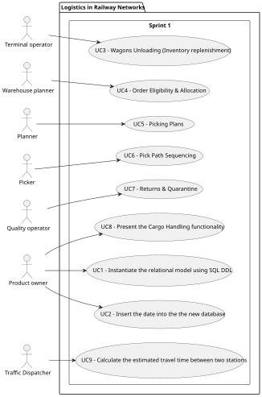

# Use Case Diagram (UCD)

# Use Cases / User Stories
| UC/US          | Description                                             |                   
|:---------------|:--------------------------------------------------------|
| USBD03 (BDDAD) | [Relational model to be instantiated using the SQL DDL] |
| USBD04 (BDDAD) | [Insert the date into the the new database]             |
| USEI01 (ESINF) | [Wagons Unloading (Inventory replenishment)]            |
| USEI02 (ESINF) | [Order Eligibility & Allocation]                        |
| USEI03 (ESINF) | [Picking Plans]                                         |
| USEI04 (ESINF) | [Pick Path Sequencing]                                  |
| USEI05 (ESINF) | [Returns & Quarantine]                                  |
| USLP02 (LAPR3) | [Present the Cargo Handling functionality]              |